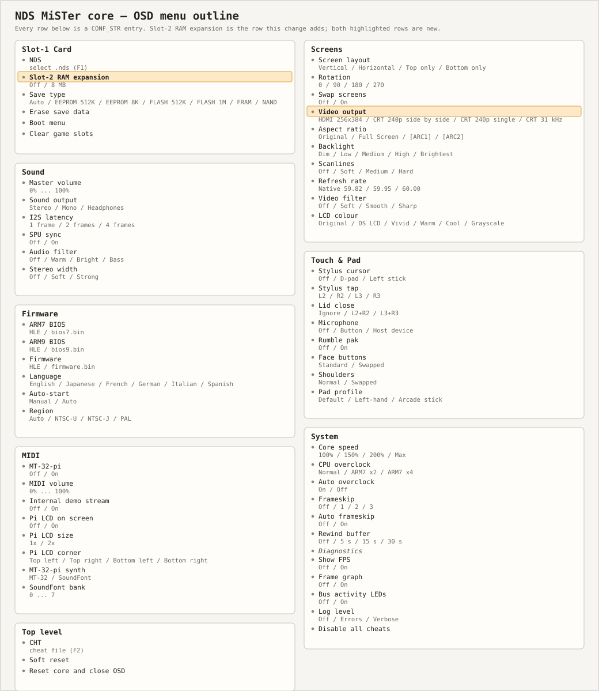

# NDS MiSTer Test — the core

A Nintendo DS core for the MiSTer FPGA platform, written in SystemVerilog.
Goal: the full library — every region, every cartridge — running at the
console's native 59.826 Hz with cycle-timed CPUs, both 2D engines, the 3D
rasterizer and a complete OSD menu.

This directory is the hardware. The website in this repository (landing
page + OSD Lab) is the **menu prototype and specification** for the OSD
below — the two are intentionally kept in step.

## Status

Honest state: **M1 and M2 complete, M3 and M4 working, M5 and M6 partial** —
and "working" here means the list below, with nothing implied. Every block
named is implemented and has a testbench that exercises it; what is not there
is written down rather than left to be discovered:

- **M3, the 3D path** — the GXFIFO stream, the serialised matrix multiplier,
  triangle assembly, a flat RGB555 rasteriser, the VRAM write-back and the 3D
  layer's compositing over engine A are in and measured. Missing: W-buffer
  depth test, fog, edge marking, toon shading, the alpha test, QUADS and
  QUAD_STRIP (their vertices are consumed, nothing is drawn), and the span
  fill — the rasteriser walks the bounding box a pixel per cycle, which is
  correct but slower than the hardware's budget for a dense mesh.
- **M4, sound, saves and the cartridge** — the sixteen SPU channels, the
  AUXSPI probe with the emulated chip behind it (EEPROM and FRAM read *and*
  write), the MT-32-pi MIDI link and the system I/O a firmware boot needs are
  in. Missing: the SPU's two capture units (`0x4000508`), the two FLASH parts'
  *upper* address space (they carry data below 64 KB — see `tb_flash_save` —
  and read `FFh` above it), `.sav` persistence and erase, and the `0x0555`/`0x0AAA` cart unlock sequence.
- **M5, sensors** — the microphone is Off / R3 button / Host device. Host
  device is the board's LTC2308 converter, one channel at 48 kHz, which is the
  only input path there is: the HPS has no audio capture, so a USB microphone
  (including one on a controller's headset jack) cannot reach the core — the
  microphone has to be wired to the ADC pins. The rumble pak answers its
  open-bus pattern and drives the pad's motors from the slot-2 latch; the lid
  is a chord on `EXTKEYIN`. Missing: local DS-to-DS wireless.
- **M6, the front end** — the cheat engine and the DS-native menu are in; save
  states, rewind and replay are rows in that menu whose hardware does not
  exist yet.

Underneath that: the framework wiring, the OSD menu, the memory map, the
SDRAM controller, the complete video path, the input path (DS keys, stylus,
mic) and the DDR3 cartridge path for 256 Mbit+ games are real and simulate
correctly. The rebuilt system bus
is complete and simulated: `main_bus` decodes the DS memory map,
serves both CPUs and the DMA engine from private WRAM/IO/BIOS regions
with round-robin arbitration, sequences 32-bit accesses over SDRAM
halfwords through `mem_arbiter`, bridges the cart window, and patches
RAM reads through the Action-Replay parser in `cheat_engine` (GBATEK
type table). M2 added the first real 2D path: `renderer_2d` renders
text BG0-3, OBJ sprites and the backdrop through a double-buffered
line pipeline fed by VRAM, wrapped by `engine_a` / `engine_b`;
`vram_arbiter` implements the VRAMCNT bank map with per-master
(CPU / engine A / engine B) window decode on the third SDRAM master;
`dma_engine` implements all four GBATEK DMA channels with
immediate/vblank/hblank triggers, repeat and completion IRQs, and
`sdram_ctrl` keeps a row open per bank (precharging before a new row and
before each refresh) so scanline traffic does not pay ACT + tRCD per
access. On top
of that, the video/audio filter layer (`video_filter`, `palette`,
`audio_filter`) is wired into the output chains. M3's 3D path:
`geometry_engine` decodes the GXFIFO command stream, holds the
projection and modelview matrices with a push/pop stack, maps vertices
through the viewport and feeds `raster_engine`. Every multiply in that
path — the 4x4 composite, the vertex transform, the viewport map and the
MTX_SCALE/MTX_TRANS products — is one time-multiplexed 64x32 multiplier:
10 clocks a vertex, 64 to rebuild the composite, 12 and 9 for the two
matrix commands. That took the engine from 22,433 ALUTs and 106 DSP
blocks to 4,319 and 6 (AREA.md item 1). `raster_engine` then assembles
triangles (and strips), clips them to the 256x192 screen, fills them
with a flat RGB555 colour and hands each pixel to `vram_arbiter` through
a request/acknowledge handshake. Pixels land in the bank whose VRAMCNT
MST selects the 3D engine as a 96 KB 256x192 16-bpp frame (a 128 KB
bank, so A or I under this module's bank-size model), and engine A now
composites that frame over its own line: after the BG and OBJ passes,
`renderer_2d` streams the line's 256 frame halfwords back through a
dedicated 3D read master on `vram_arbiter` and merges every covered
pixel (bit 15 set) through the same priority resolver, taking BG0CNT's
priority for the layer and DISP3DCNT bit 0 as its enable, per GBATEK.
That merge is measured, not assumed, and measured through the real
memory chain (`tb_3d_path` runs vram_arbiter, mem_arbiter, sdram_ctrl and
a protocol-checking SDRAM device model).

Both CPUs are real cores. `arm9_core` (ARM946E-S) and `arm7_core`
(ARM7TDMI) fetch, decode and execute through their own masters on that
bus — no BIOS image, so each boots from the active slot's cart header
entry point (0x24 / 0x34) — and each has a bench that runs hand-assembled
programs against a bus model with the same protocol (`tb_arm9`,
`tb_arm7`).

A `SWI` no longer needs a BIOS image to do anything. `swi_hle` is a small
bank of the BIOS calls a DS game actually makes, shared by both cores:
**Div** (`09h`), **Sqrt** (`0Dh`), **CpuSet** (`0Bh`), **CpuFastSet**
(`0Ch`), **LZ77UnCompWram/Vram** (`11h`/`12h`), **RLUnCompWram/Vram**
(`14h`/`15h`), **Halt** (`06h`), **IntrWait** (`04h`) and
**VBlankIntrWait** (`05h`). Each core traps every `SWI`, sets its SVC bank
up exactly as the exception would, and hands the number to the engine; the
engine issues the reads and writes the call needs through the same bus
master the core uses (one access in flight, address and byte enables held
with the strobe, `ack` in the cycle the bus answers), then the core writes
back the registers GBATEK says the call returns and performs the exception
return from `SPSR`. A number the bank does not implement still vectors to
`08h` with `LR`/`SPSR` set, so unknown calls behave exactly as before;
`SoftReset` and `WaitByLoop` are deliberately not in the bank.

Where the hardware is the interface, the engine talks to it rather than
faking the result: `IntrWait` writes `IME`, reads `IE`/`IF` and returns
only when the requested flags fire (clearing them when the discard bit is
set), `Halt` waits on the same `IE & IF` condition, and the decompressors
stream through the bus a byte at a time, so VRAM writes land through the
vram path with the rest of the memory chain in the way. `Div` is 32
restoring steps and `Sqrt` 16 digit pairs, so neither needs a divider or a
lookup table: the whole bank is control logic on one adder and one bus
access at a time (`tb_swi_hle`, plus a BIOS-call program in each core's
bench that runs the trap, the engine and the return).

There is **one** engine, not one per core. `swi_share` arbitrates it
round-robin (the caller that ran last yields, so neither can starve the
other), routes its bus access onto the owner's master and hands the
completion back to that core only — so a Halt or IntrWait still reads the
caller's own `IE`/`IF`, and a `Div` aimed at the ARM9's memory cannot be
served out of the ARM7's. A core whose call is not yet granted simply keeps
its `SWI` state, exactly as it would keep it waiting on slow memory
(`tb_swi_share`: both calling in the same cycle, round robin both ways, an
SWI outside the bank, CpuSet on each side, and the ARM7 calling with `ce7`
at half rate).

`clk_sys` is the DS's own 67.0274 MHz, out of a PLL: [`rtl/pll.v`](rtl/pll.v)
multiplies the framework's 50 MHz reference up with a fractional-VCO
MegaWizard PLL in direct mode (`rtl/pll/pll_0002.v`, `derive_pll_clocks` in
`NDS.sdc`), and the machine stays in reset until `locked` is high. That is
what makes the CPU domain nominal rather than scaled: the ARM9 runs at its
real 67.0274 MHz, and the ARM7's enable is exactly half of it, 33.513982 MHz.
The DDR3 side is the one thing that stays behind, on the 50 MHz reference the
framework's DDRAM IP and its PHY phase were generated for —
[`rtl/cart/ddr_bus_bridge.sv`](rtl/cart/ddr_bus_bridge.sv) is the single
crossing between the two, and the only place a cart transaction changes
domains.

They run at the DS's 2:1 ratio. `cpu_ce` turns that one clock into the pair
of enables the two CPUs really have — the ARM9 on every cycle and the ARM7
on every second one — with the OSD's *CPU overclock* row choosing the pattern
(ARM7 ×2 gives the ARM7 every cycle, ARM7 ×4 the same 2:1 pattern the other
way round). What makes that usable is
`cpu_ce_bridge`, which sits between each core and the fabric: the bus
answers a master once and then blocks it until it retires the access, so a
response landing on a gated-off cycle would hang the core for good; the
bridge holds it until the core's next enabled cycle instead.

What the ratio does *and does not* do is worth stating, because it is
easy to expect the wrong thing. The ARM7's own cycles become twice as long
— a two-core bench measures exactly two `clk_sys` cycles per ARM7 cycle,
and the ARM7 takes 1.12x the ARM9's wall-clock time on the same program
(1.00x with *ARM7 ×2*, with the enable as the only difference). It is not
2x because GBATEK times the DS's memory in 33.5 MHz bus units, and both
CPUs pay the same wall-clock time for the same access — a 32-bit
nonsequential main-RAM data access is 10 units either way, 10 ARM7 cycles
or 20 ARM9 cycles for the same 298 ns — and melonDS scales ARM9 time, not
ARM7 time, in its scheduler. So the shared memory path is *not* slowed for
the ARM7, exactly as on the real board; the ARM7's disadvantage is its own
execution rate, while the ARM9's is the caches and TCM this core still
lacks (with every fetch coming off the bus, both cores are memory-bound).

The peripherals the ARM7 owns are ticked by that same enable rather than by
a timebase of their own, because on the DS they are dividers of it: GBATEK
gives the timers `F = 33.513982 MHz` for *both* CPUs, and the DMA moves one
bus beat per bus clock. Both now run on `ce7`, which is what makes their
timing follow the CPU's — a timer counts ARM7 cycles, so a game's
cycle-counted delays land on the right number of cycles however the OSD
overclocks — keeps both hardware ratios (the ARM9 sees two timer ticks per
own cycle, the ARM7 one), and makes *ARM7 ×2* mean the ARM7 *domain* rather
than just the core. A bench pins it down: 2000 clocks at Normal give the
timer exactly 1000 counts, ×2 gives 2000, and the ARM9's own timer set
counts that same clock without following the ARM9's enable.

Two things deliberately stay on absolute time. The RTC is a Seiko S-35180
that counts its own crystal, so its one-second divider is fed from a
free-running reference (`clk_sys`/2 = 33.5137 MHz, independent of the OSD
overclock row) and does not move when the CPU domain does — a clock chip that
lost time with the ARM7 would be a bug, not emulation. And the 48 kHz audio
path keeps its rate: the SPU's sample counters are what set pitch, and they
run on their own dividers — the channel state at `clk_sys`/4 = 16.756991 MHz
(the DS's own 33.513982/2) and a 48 kHz mix tick accumulated against
67.0274 MHz — so neither the overclock row nor the ARM7's enable can detune a
game by even a cent. What the ARM7 actually needs from the audio side —
ARM7-only registers, bus-paced fetches — the fabric already gives it.

M4's audio work came from the outside in: the DS has no MIDI
hardware, so the ARM9 AUX SPI port at `0x04000150` is turned into a real
31.25 kbaud MIDI link (`rtl/audio/midi_port.sv`) for an MT-32-pi on the
user port, with its 48 kHz I2S return mixed back in by
`rtl/audio/audio_mix.sv` under its own OSD volume. Both directions and
the mix are simulated, and the DS side of that mix — the sixteen-channel
SPU — is now the real thing rather than a framing stub.

### The console's housekeeping I/O

Comparing the register coverage against melonDS and DeSmuME (their SPI,
RTC, SPU and wifi modules) turned up three things the two emulators treat
as mandatory and this core did not have. Two of them are now here.

**The real-time clock** ([`nds_rtc`](rtl/bus/nds_rtc.sv)) is not a
register file: `4000138h` is a three-wire port the ARM7 bit-bangs (data,
clock, select), and the part is a Seiko S-35180 that takes an LSB-first
command byte and then shifts its parameters across the same three lines.
The core decodes all eight commands (status 1/2, date and time, time,
both alarms, clock adjustment, free register), keeps the counters in BCD
with month lengths and leap years, accepts the write path so a game's set
clock round-trips, and latches a snapshot when the command byte completes
— which is why a seconds rollover in the middle of the seven-byte date
read cannot tear it. The edge is taken on the write that raises the clock
and the data line moves on the falling edge, matching the part's timing
rather than a cycle later.

**The SPI bus** ([`nds_spi`](rtl/bus/spi.sv)) carries the firmware flash,
the touchscreen controller and the power management device, selected by
`SPICNT[9:8]`. Bytes shift MSB first, one clock per bit; the reply for
each byte is prepared at the end of the previous one, and the chip select
(the hold bit) genuinely ends a command, so a sequence that forgets to
hold it behaves as it would on hardware.

* **Firmware, HLE.**  Games read the user settings that live in the wifi
  flash at `3FE00h`/`3FF00h` — nickname, language, alarm, touch
  calibration, language. Rather than carry the owner's 256 KB dump, those two
  blocks are synthesised by a generated table ([`fw_default`](rtl/bus/fw_default.sv),
  from [tools/gen_fw_default.py](tools/gen_fw_default.py)) in GBATEK's
  layout *with valid CRC16-CCITT protection*, and writes are shadowed in a
  512-byte RAM. The OSD **Language** row picks the language halfword and the
  CRC that covers it, so a game's text language follows the menu. RDID/RDSR/READ/FASTREAD/WREN/WRDI/PP/PW/PE/SE are the
  part's own commands: programming only clears bits, a page erase walks
  the shadow a byte per clock, and the write-enable latch and busy bit
  follow through. Reads outside the two blocks return `FFh`, as an erased
  part does.
* **Touchscreen.**  The TSC2046 command byte (start bit, channel, 8/12-bit,
  single/differential) is decoded for X, Y, both pressure channels, the
  battery sensor, the microphone and temperature. X and Y come from
  `input_mapper`'s stylus position through exactly the calibration the
  synthesised firmware advertises, so a game's readback and its settings
  agree; a released panel reports `000h` for X and `FFFh` for Y, per
  GBATEK.
* **Power management.**  Index byte then data byte: register 0
  (amplifiers, backlights, LEDs), 1 (battery), 2-3 (microphone amplifier
  and gain), 4 (brightness/power source). A write round-trips, so a game
  that enables the amplifier and reads it back sees what it wrote.

Both blocks sit in [`sys_io`](rtl/bus/sys_io.sv) with the timers, IPC,
maths unit and IRQ banks, decode at `main_bus`'s I/O window, and raise the
interrupts the DS wires them to: the SPI completion on ARM7 `IF.23`, and
the RTC's `/INT` on the SIO line, `IF.7`.

### The sixteen sound channels

The third thing those emulators treat as mandatory is now here too:
[`spu`](rtl/audio/spu.sv) replaces the framing stub with the real channel
engines. Each channel is a sampler. `SOUNDxCNT`/`SAD`/`TMR`/`PNT`/`LEN`
are a complete register file, a 16-bit counter in the 16.757 MHz half-rate
domain wraps every `65536 - TMR` ticks and asks a shared decode engine for
one unit (two PCM8 samples, one PCM16 sample, or four ADPCM nibbles out of
one 16-bit fetch), and the result runs through volume/128, the volume
divider, panning into left/right and the master volume into the 48 kHz
mix, clamped rather than wrapped. All three sample formats are GBATEK's:
signed PCM8 used as `sample << 8`, little-endian PCM16, and IMA-ADPCM with
the documented staged-shift decode against the 89-entry step table, whose
step index clamps at both ends.

Two details there are easy to get wrong and are worth stating. **Looping
restores the loop point's own state:** GBATEK says to set the loop start
into the data rather than the header, because "the index and pcm16 values
are reloaded to the values that have originally appeared at that
location" — melonDS snapshots them (`ADPCMValLoop`/`ADPCMIndexLoop`) as
the position passes the loop point and restores them on each loop, and
DeSmuME does the same (`loop_pcm16b`/`loop_index`), so the loop point's
bytes decode as ordinary nibbles on the first pass. Only a loop point of 0
gets its header read again, since that is where the header lives. **PNT+
LEN below four words hangs** with the busy bit set and no sound, exactly as
documented, and a one-shot's last sample is played before the channel goes
silent (or holds it, with `SOUNDxCNT` bit 15).

Sixteen parallel decoders would mean sixteen step tables and forty-eight
multipliers, so the channels are served one at a time by a shared
four-phase engine — latch, decode, scale, pan — with one table, one nibble
decoder and three multipliers for the whole SPU. A channel whose counter
wraps is held until its unit has been served, so a busy part cannot drop a
sample, only delay it a few clocks. Sample fetches are their own
`mem_arbiter` master at the lowest priority, one halfword per request; the
`spu` bench drives the register window the way the CPU does against a
sample-RAM model with a real handshake, and compares its captured 48 kHz
output with goldens from [tools/gen_spu_vectors.py](tools/gen_spu_vectors.py)
— an independent implementation of the documented decode and of this
core's scaling chain.

**Still missing against those emulators:** the SPU's sound-capture units
(the sixteen channels themselves are implemented, see below), wifi,
and the 3D features melonDS
and DeSmuME give the rasterizer (textures, lighting, fog, toon shading,
edge marking). DSi-only extras — the extended RTC command set, DSi-mode
SPI, the 4 KB DSi flash — are out of scope while the core targets NDS.

| Subsystem | melonDS / DeSmuME | this core |
|---|---|---|
| ARM9/ARM7, CP15, bus, DMA, timers, IPC, maths, IRQ, HALT | yes | yes |
| RTC (`4000138h`) | yes | **yes** (no alarm `/INT`) |
| SPI: firmware, touchscreen, power | yes | **yes** (firmware HLE, no dump) |
| AUXSPI cartridge saves | yes | yes (chip + probe; no save controller yet) |
| 2D engines A/B, VRAM banking | yes | yes |
| 3D geometry/raster | yes | flat-shaded, untextured |
| SPU channels | yes | **yes** (no capture units) |
| Wifi, DSi extras | yes | no |

The fetch is a **read burst**, not a request per pixel, and that is what
made the layer fit its scanline. `sdram_ctrl` takes `rd_bst` + length +
stride, issues one READ per clock while the row is open and streams the
beats back on `bst_valid`; `mem_arbiter` grants a burst as one transaction
and forwards the stream; `vram_arbiter` hands it to whichever master was
granted. The merge pass asks for four 64-pixel chunks per line and
composites each beat the cycle it arrives. Measured in `tb_3d_path`: **322
clocks per line** uncontended (1139 when a 2D BG fetch collides with it)
against a 1280-clock line period, down from 3965 with per-pixel requests —
the merge now finishes well inside the line and the 3D layer holds a
steady image instead of repeating a line. The controller's own numbers,
from `tb_sdram_ctrl`: 64 halfwords land in 73 clocks (one ACTIVE, ~1.14
clocks/beat) versus ~10 clocks each on the single-access path, 78 clocks
when the walk crosses a bank/row boundary and precharges mid-burst, and 73
for the strided variant.

### The 2D fetch is burst-based too

`renderer_2d` used to issue one VRAM request per halfword, which is why a
BG line cost more than its 1280-clock period. Both engine ports on
`vram_arbiter` are now burst ports (`*_len` in, `*_bs_valid`/`*_bs_data`
out, `*_ready` at the end of the run), and the renderer fetches in the
units the hardware has:

* **A whole map row per fetch.** GBATEK's map blocks are 32x32 entries, so
  one burst of 32 halfwords covers a full row half; a 64-wide map takes
  two (the right half is 2 KB above the left). The row lands in `map_row[]`
  and every column entry is read from that buffer, so 32 tile columns cost
  one grant instead of 32.
* **A whole tile row per fetch.** Four bytes at 4 bpp, eight at 8 bpp, in a
  double buffer: while column N's 8 pixels composite, column N+1's row
  streams into the other buffer, so the fetch hides behind the composite
  instead of stalling it.
* **A whole sprite row per fetch** (w/4 or w/2 halfwords) into `sbuf[]`,
  instead of one round trip per halfword while drawing.

Measured in `tb_renderer_2d`, which charges a grant latency plus one clock
per beat and counts both: a 256-pixel 4bpp BG line with two 8x8 sprites and
the 3D merge takes **1039 clocks total — BG 425, OBJ pass 330, merge 284** —
in **35 grants / 100 beats**, against roughly one grant per halfword (~98
for this line) before the fetch became bursts. The BG phase alone is **425
clocks of the 1280-clock line period**; an 8 bpp 64x64-map line takes 512
clocks (34 grants, 192 beats, both map halves and four-halfword tile rows).

Each column of that walk now costs its eight pixels plus whatever is left of
the prefetch. The 4bpp palette-bank check and the next column's fetch ride on
the cycle that advances the column — where they used to be two states of their
own, and raising the fetch there is a clock earlier than the state it replaced
— so the burst lands behind the eight pixels and the wait between columns is
skipped outright. That took the BG phase from 567 to 504 clocks and the whole
line from 1196 to 1133. The backdrop fill, which wrote one pixel pair a clock,
now writes a quad — the line-buffer entries are 84 bits — so its 128 clocks are
64 and the line is 1069. Both palette-bank fills then stopped paying a
handshake per entry: the sixteen entries are issued one address a clock and read
two clocks behind, 17 clocks where it used to be 32, for the 4bpp BG bank and a
sprite's OBJ bank alike. Another 30 off the line — BG 440 -> 425, OBJ 345 -> 330
— and it is 1039 (`vvp /tmp/tb_rd +states` prints the per-state histogram the
figures come from).

### The per-line OAM scan is a pipeline

The OBJ pass was the next long pole: 128 OAM entries scanned with a
handshake per attribute cost **820 clocks**. The second OAM port is a
one-address-per-clock BRAM read (`oam_rd_a <= oam[oam_ra_a]` in
`main_bus`), so `renderer_2d` now walks OAM as a pipeline: ATTR0 of an
entry is issued the clock before its ATTR1, the y/height test runs as
ATTR1 comes back two clocks later, and no clock is idle. That is **258
clocks for all 128 entries**, down from 820 for the pass.

Hitting a sprite must not stop that pipeline — one attribute would be in
flight and get lost — so the walk records the entries that passed the test
in a 32-entry hit list and the sprite path draws them afterwards, in OAM
order (32 hits per line is the cap; the sprites beyond one are simply
dropped rather than corrupting the walk). Each sprite then costs its three
attribute reads plus the row burst it already paid for.

The same pass fixed an addressing bug the old code hid: an OAM entry is
four halfwords, but the address was `3*n + ostep`, so entry 1 would have
read entry 0's ATTR3. It is `4*n + ostep` now, and `tb_renderer_2d` puts a
second sprite in entry 1 to prove it.

So a sprite line fits: **1039 clocks against 1280** with two sprites and
the 3D layer on. Still open: 8 bpp BG resolves one palette colour per
read, a sprite wider than 8 pixels is addressed as one contiguous row
instead of GBATEK's 1D tile order (a pre-existing simplification, now a
single address function, `shw_addr`, that the row burst follows), a line
with more than ~30 sprites will still overrun, the fill is one pixel per
cycle versus the hardware's 15-cycle polygon budget, and depth/fog/edge
marking, alpha test and QUAD primitives are not implemented.

### VRAM addressing

The VRAM window is byte-addressed (0x06000000 + byte offset) and the
storage behind `vram_arbiter` is 16-bit, so the arbiter's decode halves
the window offset (`phys = bank_base + offset/2`) for every master: the CPU
window, the engine A/B fetch ports and the 3D frame alike. One address
unit per byte, one stored halfword per address unit, so consecutive
halfwords are one slot apart. That is what makes the bursts contiguous:
a 16-bpp frame pixel is the halfword at window offset `2*x`, the 96 KB
frame fits in a 96 KB slice of its bank, and a 64-beat BG run or a 256-pixel
line merge is one linear stream with no unused beats and no stride tricks.
`tb_3d_path` checks the layout end to end (pixel `(1,0)` sits at the very
next halfword after pixel `(0,0)`), and `tb_vram_arbiter` checks that both
the CPU window and the engines see the same storage.

## Memory & cartridge sizes

Pure DS support, region-free. The full ROM image is stored in the
DE10-Nano's **DDR3**, so every cart size fits without banking:

| Size | Example | Where it lives |
|------|---------|----------------|
| 32 MB / 256 Mbit | most late-era DS titles | DDR3 |
| up to 512 MB / 4 Gbit | DS maximum | DDR3 |

The download stream is buffered in a 64-line FIFO; `ioctl_wait` pauses
the HPS if DDR3 contention (with the scaler) backs up — no bytes can be
dropped. Header byte 0x80 (device capacity) is captured into
`rom_bytes`. SDRAM holds main RAM, WRAM overflow, VRAM bank storage
and cart save data; `mem_arbiter` shares it between the bus RAM window
(CPU traffic), the cart save path (fixed priority, saves are
latency-sensitive bursts) and the VRAM path behind `vram_arbiter`. The
space above those regions is free, and the optional Slot-2 RAM expansion
pak takes 8 MB of it (SDRAM 0xA00000, seen by both CPUs at
0x09000000..0x097FFFFF), switched by the **Slot-2 RAM expansion** OSD
row; with the row Off nothing decodes there, which is what a DS with an
empty slot sees. `EXMEMCNT.7` does not gate it: on hardware that bit is
GBA-slot ownership (0 = ARM9, 1 = ARM7, GBATEK), and the core keeps it as
the plain read/write register it is, so the OSD row alone is the pak's
presence. The cart window read bridge (`win_*`) is wired to
`main_bus`
with a pending latch so a request survives DDR busy periods. A line is
8 bytes and a fetch burst walks the four halfwords in it, so the read
side keeps the line it last fetched (`pf_line`/`pf_data`) and answers
the other three halfwords without touching DDR — one round trip per
line instead of one per halfword. The cache is dropped when a download
rewrites the slot and when the slots are cleared, so it can never serve
bytes from the game that was just replaced.

### Four game slots and the boot menu

A MiSTer core never sees the SD card. The HPS opens one file per OSD
selection and streams it over `ioctl`; there is no directory call, so a
core cannot list a games folder however much it might want to. What a
core *can* do is hold more than one game, which is what this one now
does:

- **Four slots, 64 MB each** (256 MB of the 1 GB DDR3). 64 MB is forced
  by the cart window itself — `win_addr` is 26 bits, so a game can only
  ever see that much — and each slot's region is a fixed `slot << 23`
  line offset, so a download never straddles another game.
- **Names without file names.** The first 16 bytes of every DS ROM
  header are kept per slot as the download streams past: `0x00..0x0B` is
  the title in ASCII and `0x0C..0x0F` the four-character game code (`AMCE`
  is Mario Kart DS, USA). The menu renders both with the 5×7 font. No
  HPS involvement, no sidecar list file, no parsing of the SD card — and
  the code is what tells two regional variants apart, since they share a
  title.
- **Sizes come from the header too.** Byte `0x80` of the same header is the
  capacity the game declares, latched per slot and drawn right aligned in
  columns 23..26 (` 32M`, `128M`, `512M`). A slot holds 64 MB, so this is
  what shows, before `A` is pressed, that a 128 MB game will be cut off
  when it loads; the footer repeats `64M SLOT` for the limit itself. It is
  the declared size rather than the file's length, so a trimmed dump still
  reports the full figure, and a file that never presents byte `0x80` shows
  no size at all instead of a guessed one.
- **Each slot's save type is measured, not remembered.** A DS cartridge
  cannot tell you one: the header has no save-type field. A real cart is
  classified by probing its AUXSPI interface (GBATEK, *DS Cartridge
  Backup*), so that is what the core does: `rtl/cart/save_spi.sv` is the
  chip the slot describes — ST M95512, M95640, 45PE40V6, 45PE80V6 or the
  Ramtron FM25L256 — and `rtl/cart/save_probe.sv` walks the same sequence a
  real M4 would. The answer, not the OSD row, is what the menu draws in
  columns 28..31 as `AUTO`, `E512`, `E8K`, `F512`, `F1M`, `FRAM` or `NAND`.
  The row still *seeds* the cart: it says which game is being loaded, so
  the probe has a part to interrogate, and it edits the active slot's game.
  Two consequences are drawn rather than hidden: `AUTO` (no part) shows
  nothing, and a `NAND` record shows nothing either, because NAND cartridges
  answer the SPI backup commands with open bus (FFh) — the column reports
  what the bus said. The probe writes a two-byte signature, reads it back
  through the candidate address mirrors to size the part, and restores the
  original bytes, so an existing save image is left as it was found.
- **A save image loads into the cart's chip.** `rtl/cart/save_file.sv` takes
  the `.sav` the HPS downloads — recognised by the file's own extension
  through `ioctl_file_ext`, not by a guessed index — and writes both bytes of
  every word into the chip's memory. The chip backs 64 KB of a FLASH part, so
  a longer `.sav` loads its first 64 KB and the rest is dropped, which is the
  chip's own documented truncation. Writing the save back out is **not**
  built: it needs a second read port on that memory, which infers a second
  64 KB array and puts the design 164 combinational nodes past the device's
  limit (83,984 against 83,820). Sharing the one port instead leaves the
  array uninferred. `AREA.md` records all four attempts and their numbers; the
  write direction is the open item, not a working feature.
- **A download fills the lowest empty slot**, or overwrites in rotation
  once all four are full, and the new game boots straight away as before.
- **The slot list survives a core reset** (it is in the cart, not in the
  reset domain), because booting a game *is* a core reset; otherwise the
  menu would empty itself the moment it was used.

`Select` on the pad, or **Cartridge → Boot menu**, opens the picker:
eight-pixel cells, 32×48 characters, four rows each showing the slot number,
the ROM's title, its game code, the size it declares and that slot's save
type — columns 7..16, 18..21, 23..26 and 28..31, one blank cell between
fields, the highlighted row barred from column 4, and `Up`/`Down` to move.
`A` resets the core onto the highlighted slot through the same reset path as
`R`, so a game switch is a clean boot that brings that slot's own save type
with it and leaves everything else unchanged. An empty slot does nothing,
and when nothing has been staged the menu says `NO GAMES LOADED` rather
than showing four blanks. **Clear game slots** empties the list.

Where the games come from: **Cartridge → NDS** is the `.nds` loader — the
`F1` entry declares the `NDS` extension, and the HPS matches extensions
case-insensitively (`ScanDirectory` compares with `tolower`), so `.nds`,
`.NDS` and `.Nds` all list. The browser opens in `/media/fat/games/NDS`,
the folder the core itself lives in. All of that is the HPS's side of the
wall: the core is handed bytes and nothing else, which is why the menu
names games from their headers instead of file names. Should another
extension ever be wanted, MiSTer packs them three characters each with no
separator (`F1,NDSBIN`).

`rtl/video/boot_menu.sv` draws straight into the video path the way the
panel overlay does — one pixel clock enable, DE/HS/VS carried through — so
it costs no frame buffer and no BRAM beyond the font. Its character map
leaves `0x20` as a blank cell (a space is a space, not the `?` fallback),
`0x00` as the padding short titles end with, and anything else unmapped as
`?`.

## Layout

```
fpga/
  NDS.sv                  core top (module emu): OSD menu, status decode,
                          instantiates everything below
  NDS.qpf / NDS.qsf       Quartus project (adapted from Template_MiSTer)
  NDS.sdc                 timing constraints (Template-style; top-level
                          clocks come from sys/sys_top.sdc)
  files.qip               source list — add new files HERE, never in the IDE
  sys/                    MiSTer framework vendored from Template_MiSTer
                          (hps_io, osd, scaler, sys_top, PLLs, pins) —
                          keep in sync with upstream, do not edit
  rtl/
    pll.qip / pll.v       core PLL wrapper required by the framework
                          (sys/pll_q17.qip references it)
    video/video_timing.sv     HDMI 256x384 plus three CRT modes (240p
                              side by side, 240p single, 31 kHz); the
                              HDMI refresh is 59.82/59.95/60.00 Hz
                                                            [SIM-VERIFIED]
    video/screen_composer.sv  dual-screen placement, rotation,
                              swap, brightness            [SIM-VERIFIED]
    video/video_filter.sv     spatial filter: soft/smooth/sharp
                              (one-line buffer, 1 CE latency) [SIM-VERIFIED]
    video/palette.sv          colour profiles: DS LCD, vivid,
                              warm, cool, grayscale         [SIM-VERIFIED]
    video/lcd_overlay.sv      MT-32-pi OLED stream -> 8 Kbit
                              framebuffer -> picture overlay    [SIM-VERIFIED]
    video/boot_menu.sv        in-core game picker: slot title + game
                              code, drawn over the picture, pad-driven
                                                                [SIM-VERIFIED]
    video/font5x7.sv          5x7 font for the menu (A-Z, 0-9,
                              punctuation)                     [SIM-VERIFIED]
    video/renderer_2d.sv      shared 2D text renderer: BG0-3, OBJ,
                              backdrop, palette cache, line buffers,
                              burst fetch (map row / tile row / sprite
                              row), pipelined OAM scan + hit list,
                              3D layer merge (engine A)    [SIM-VERIFIED]
    video/engine_a.sv         2D engine A wrapper (reg/pal/OAM/VRAM)
                              [SIM-VERIFIED]
    video/engine_b.sv         2D engine B wrapper              [SIM-VERIFIED]
    video/vram_arbiter.sv     VRAMCNT bank map, MST decode,
                              CPU>3D>engine grants, 3D frame write and
                              read masters, burst ports for engine A/B
                              and the 3D read, SDRAM master   [SIM-VERIFIED]
    video/geometry_engine.sv  GXFIFO decode (GBATEK table), 4.12 matrix
                              stack, MTX_*, VIEWPORT, VTX_16/VTX_XY, GXSTAT;
                              32-bit (4.12) vertex output          [SIM-VERIFIED]
    video/raster_engine.sv    triangle/strip assembly, bbox clip, edge-
                              function fill, RGB555 pixel stream  [SIM-VERIFIED]
    cpu/arm9_core.sv          ARM946E-S: ARMv5TE ARM + Thumb
                              (BLX, CLZ, the QADD/QSUB family, SMUL/SMLA xy,
                              LDRD/STRD), CP15, CPSR/SPSR banks, the six
                              exception vectors, HALT, bus master, one-word
                              fetch buffer                [SIM-VERIFIED]
    cpu/arm7_core.sv          ARM7TDMI: ARMv4T ARM + Thumb, CPSR/SPSR
                              banks, exceptions, HALT, bus master, one-word
                              fetch buffer (Thumb halfwords share a bus read)
                                                          [SIM-VERIFIED]
    cpu/swi_hle.sv            the BIOS SWI bank: Div, Sqrt, CpuSet/CpuFastSet,
                              LZ77/RL decompress, Halt, IntrWait/VBlankIntrWait,
                              one bus access in flight
                                                          [SIM-VERIFIED]
    cpu/swi_share.sv          one swi_hle for both cores: round-robin grant,
                              the engine's bus access routed onto the owner's
                              master, completion back to that core only
                                                          [SIM-VERIFIED]
    cpu/cpu_ce.sv             the DS's 2:1 CPU clock ratio as enable
                              patterns (Normal / ARM7 x2 / ARM7 x4)
                                                          [SIM-VERIFIED]
    cpu/cpu_ce_bridge.sv      clock-enabled bus adapter: holds a response
                              that lands on a gated-off cycle so it is not
                              lost (main_bus blocks a master until it
                              retires the access)            [SIM-VERIFIED]
    bus/main_bus.sv           DS memory map, both CPUs + DMA, round-robin,
                              cart window, VRAM, engine ports, GX command
                              window, cheat patch, timers ticked from the
                              ARM7's clock enable             [SIM-VERIFIED]
    bus/dma_engine.sv         4 GBATEK DMA channels: immediate/vblank/
                              hblank, repeat, IRQ, paced on the ARM7's clock
                              enable (a response cannot be lost to the gate)
                                                          [SIM-VERIFIED]
    mem/sdram_ctrl.sv         32 MB SDRAM controller (CL3, refresh, BE,
                              one open row per bank, PRE before a new
                              row, PRE-ALL before refresh, strided
                              read bursts, one READ per clock
                                                          [SIM-VERIFIED]
    mem/mem_arbiter.sv        three-master SDRAM arbiter (bus + save + VRAM)
    cart/cart_slot.sv         ROM -> DDR3 with line FIFO + backpressure,
                              capacity detection, CPU window bridge,
                              four 64 MB game slots + ROM header titles
                                                          [SIM-VERIFIED]
    cart/ddr_bus_bridge.sv    the cart's 67.0274 <-> 50 MHz crossing:
                              one 64-bit line per transaction, level ack
                                                          [SIM-VERIFIED]
    cart/cheat_engine.sv      Action Replay DS parser (GBATEK types
                              0-A) + RAM read patching       [SIM-VERIFIED]
    input/input_mapper.sv     MiSTer pad -> DS KEYINPUT, stylus, mic
    audio/audio_filter.sv     EQ presets (warm/bright/bass) +
                              mid/side stereo width          [SIM-VERIFIED]
    audio/mt32_select.sv      OSD synth/bank -> Pi request bytes + the
                              reload pulse when either changes [SIM-VERIFIED]
    audio/spu.sv              16-channel SPU: register file, PCM8/PCM16/
                              ADPCM, looping, panning, 48 kHz mix  [SIM-VERIFIED]
  tb/tb_video_timing.sv   three refresh modes          [SIM-VERIFIED]
  tb/tb_composer.sv       dual-screen placement        [SIM-VERIFIED]
  tb/tb_video_filter.sv   pass-through, uniform blend, step edge [SIM-VERIFIED]
  tb/tb_palette.sv        colour profiles              [SIM-VERIFIED]
  tb/tb_audio_filter.sv   pass-through, width, EQ, saturate     [SIM-VERIFIED]
  tb/tb_input_mapper.sv   keys/stylus/mic              [SIM-VERIFIED]
  tb/tb_arm7.sv           ARM7 programs through a bus model: ARM+Thumb
                          decode, shifter, multiply, B/L/BL, load/store,
                          LDM/STM, halfword + signed loads, SWP, Thumb
                          PUSH/POP, BX, SWI/IRQ vectors, HALT
                                                          [SIM-VERIFIED]
  tb/tb_arm9.sv           ARM9 programs through a bus model: ARMv5TE ARM +
                          Thumb decode, the media instructions and the sticky
                          Q flag, LDRD/STRD, the DS's alignment rules, the
                          user-mode bank, CP15, the SWI/BKPT/undefined/IRQ
                          vectors, Thumb BLX/BKPT/PUSH/POP, HALT
                                                          [SIM-VERIFIED]
  tb/tb_cpu_clk.sv        both cores on the real bus: the enable pattern
                          (2:1 / 1:1 / 1:2), the same program run on each
                          core, and the ARM7's own cycles at half rate
                                                          [SIM-VERIFIED]
  tb/tb_ddr_bridge.sv     the cart's 67.0274 <-> 50 MHz crossing: one line
                          per transaction, held strobes, level ack
                                                          [SIM-VERIFIED]
  tb/tb_sys_clk.sv        system I/O on the ARM7's clock: a timer counts one
                          count per enable (both CPU's sets), the prescaler
                          divides those, and the RTC's second divider stays
                          on its own crystal reference       [SIM-VERIFIED]
  tb/tb_cart_slot.sv      DDR3 download + capacity + four game slots
                                                          [SIM-VERIFIED]
  tb/tb_boot_menu.sv      menu layout, bar, boot pulse, passthrough
                                                          [SIM-VERIFIED]
  tb/tb_main_bus.sv       fabric: masters, RAM, cart, slot-2 pak, cheat, IO [SIM-VERIFIED]
  tb/tb_cheat_engine.sv   file parse + types + guard    [SIM-VERIFIED]
  tb/tb_renderer_2d.sv    text BG/OBJ render, hflip, line swap, 3D
                          layer merge and priority, 64-wide 8bpp map
                          (two map bursts, four-halfword tile rows),
                          second sprite in OAM entry 1 (4-halfword
                          entry stride), per-line cost, per-phase
                          timing and VRAM grant counting  [SIM-VERIFIED]
  tb/tb_dma_engine.sv     4 channels, triggers, repeat, IRQ [SIM-VERIFIED]
  tb/tb_vram_arbiter.sv   bank map, MST decode, priority, 3D write-back
                          and 3D layer burst read-back    [SIM-VERIFIED]
  tb/tb_geometry_engine.sv GXFIFO decode, matrix stack, viewport,
                          vertex emission, command resync [SIM-VERIFIED]
  tb/tb_raster_engine.sv  triangle fill, strip assembly, colour,
                          clipping, degenerate primitives  [SIM-VERIFIED]
  tb/tb_3d_path.sv        end-to-end: GX triangle -> rasterizer -> VRAM
                          -> engine A composite -> visible pixel, through
                          the real memory chain             [SIM-VERIFIED]
  tb/tb_sdram_ctrl.sv     controller vs a strict device model: init,
                          open-row reuse, row crossing, byte masks,
                          refresh, request-latch coverage, linear and
                          strided read bursts              [SIM-VERIFIED]
  tb/tb_lcd_overlay.sv    panel stream captured and drawn 1:1, box
                          edges, passthrough, option off, new frame
                                                          [SIM-VERIFIED]
  tb/tb_mt32_select.sv    mode/index request, one reload pulse per
                          change, none for a bank change in MT-32 mode
                                                          [SIM-VERIFIED]
  tb/tb_mic_adc.sv        LTC2308 model on the bus: twelve bits reach the
                          sample, a later conversion replaces it, 96
                          conversions measure 2 ms (48 kHz)  [SIM-VERIFIED]
  tb/sdram_model.sv       behavioural SDRAM device with command counts
                          and protocol checks (shared by both benches)
```

## Build

Prerequisites: **Quartus Prime 17.0.x** — the MiSTer project mandates
17.0.x (17.0.2 recommended, Lite or Standard license; newer versions
introduce project-setting incompatibilities with no benefit for the
Cyclone V). The MiSTer framework is **already vendored** in `fpga/sys/`
(hps_io, osd, scaler, sys_top, PLLs, pin map) exactly as shipped by
Template_MiSTer — no copy step needed.

```bash
cd fpga
quartus_sh --flow compile NDS            # or open NDS.qpf in the IDE
```

`NDS.qsf` is set up for **area**, not speed: `OPTIMIZATION_MODE "BALANCED"`,
`OPTIMIZATION_TECHNIQUE AREA`, `ALM_REGISTER_PACKING_EFFORT HIGH` and
`SYNTH_TIMING_DRIVEN_SYNTHESIS OFF`. Mapping the same sources with the older
speed settings costs 885 combinational nodes and 962 ALMs, and those 885 nodes
are the difference between passing the mapper's `170011` node check and
tripping it, so they are worth keeping unless you deliberately trade area for
Fmax.

### Warnings

The mapper's log is triaged rather than filtered. A build reports **0 errors,
0 critical warnings and 53 warnings**, every one of which carries a numeric id
and is accounted for below, so a new code in the log is a signal instead of
noise.

Seven were real and are fixed:

- **127005, critical, twice** — the SPU's ADPCM tables have 89 and 9 entries,
  but the synthesiser builds 128-deep and 16-deep memories for them, so it
  paired each array with an initialisation file whose depth disagreed. The
  tables are now declared and zero-padded to the depth that is actually built;
  the padding is unreachable and the SPU bench reads the same values.
- **10762** — the per-game overclock lookup was a 32-bit `case`, too wide for
  the tool to check for completeness. It is a single compare now.
- **10027 on the ARM7** — `rread` indexed the 16-entry register bank with the
  instruction's five-bit field. `r == 15` is taken above it, so the index is
  0..14, and it is masked to four bits as the ARM9 core already did.
- **RST port on the PLL**, twice, no code — the framework's audio PLL and the
  core's own each had their reset tied to a constant. The message is literal:
  a PLL that loses lock then has no way to be re-locked, so the port exists to
  be driven. Each now takes the top of a 16-deep shift register clocked by its
  own reference clock, which starts the counters from a known state and
  releases long before either output is used. Measured on a throwaway copy of
  the PLL alone: constant 1 warning, pulse 0. On the full design it costs
  +139 ALMs, +127 ALUTs and +8 registers.
- **10036, all nineteen** — every module ends with the usual sink
  (`wire _unused = &{...};`) so that signals kept for debugging stay named, and
  the analyser counts a sink that is written and never read as a fault. Reading
  it from a branch that cannot be taken removes the warning and synthesises to
  nothing: measured on a throwaway module, 1 warning without the read, 0 with
  it. Nine sinks are fixed that way. The other ten are nets whose readers sit
  inside functions -- the SPSR banks in both cores and the text renderer's
  display-mode net -- and Verific's function-body analysis does not follow
  those, so the nets look dead when they are the most live state in the CPU.
  Before touching them I checked every reader: `spsr_*` is what an exception
  return restores, so deleting them would have broken the cores. Instead each
  core now has a sink over its SPSR banks, read the same way, which states the
  read that already exists and synthesises to nothing. Measured on a throwaway
  module with the same shape: 5 such warnings without it, 0 with.
- **10030, six** — the SPU's ADPCM tables are inferred as memories, and with no
  write port Quartus reports each port of each table as undriven. Entry 0 is now
  rewritten with the value it already holds, which defines the ports without
  changing a table entry. Measured on a throwaway ROM: 3 warnings with no write
  port, 1 with a never-taken write (that form also earns a 10037 for the constant
  condition), 0 with this one. Block memory is unchanged (1,873,331 bits), so the
  tables are still in M10K, and the warning fixes together come out 76 ALMs and
  103 ALUTs smaller than before them.
- **15610 twice, and 21074** — `SD_SPI_MISO` and `ADC_SDO` were top-level
  inputs that nothing in the core read. `SD_SPI_MISO` is still gone, because
  there is no secondary SD card. `ADC_SDO` is back: `mic_adc` samples the
  LTC2308 for the OSD's Host-device microphone, so `sys_top` feeds the
  converter's data line into `ADC_BUS[2]` again and the pin keeps its
  `PIN_AD4` assignment.

What is left is the tool describing its own implementation, plus the framework:

| Code | Count | What it is |
|---|---|---|
| `276020` | 10 | inferred memories whose read-during-write behaviour Quartus already matched with pass-through logic |
| `276027` | 6 | inferred dual-clock memories, where read-during-write is undefined but never exercised |
| `10034` | 7 | output ports of Intel's generated `altera_pll`/`altera_cyclonev_pll` that the IP itself leaves undriven |
| `12030` | 1 | a port width in that same generated PLL file, where the IP drives one bit of a two-bit formal |
| `14320` | 9 | nodes Quartus folded away inside the PLL wrappers and in palette RAM it did not need |
| `14284` / `14285` | 6 | the same folding reported per node, plus a RAM node it removed |
| `10027` | 3 | a variable index into a 16-entry array in each core's register file and in the SPU step table: Quartus 17 prints this for a correctly sized variable index too and not for a constant one, so it cannot be removed without making the read constant |
| `13xxx` / `13410` / `12241` | 11 | the framework's `sys_top` and the board: the secondary-SD open-drain buffers this core tri-states and never reaches a pin, the SDRAM chip select and clock enable that `sdram_ctrl` holds at 0 and 1 (selected, enabled) and Quartus therefore calls stuck, and the summary of those connectivity notes |

The read-during-write notes were audited memory by memory rather than accepted.
`rxq_mem` and `vfifo` cannot collide: both gate their push on `!full`, so the
write pointer cannot equal the read pointer being read. `comp` is rebuilt by its
state machine before the transform that consumes it. `q_mem` feeds the transmit
shift register through a combinational read, and `mem` in the backup chip is
written only during a WRITE command and read only during a READ command; in both
the edge a write lands on is after the byte has been used, so the old value is
the correct value. The rest (`ascal`, `mt32pi`, `shadowmask`) are framework
files. None of them needs a bypass, and adding one would spend timing for no
functional gain.

None of them changes what the design does, and none is suppressed: the count is
reported as it is so the next real warning is visible.

### Reduced builds

Five subsystems can be compiled out for area experiments, without touching the
default build:

```bash
quartus_map NDS --verilog_macro="NDS_NO_3D=1"      # no 3D pipeline
quartus_map NDS --verilog_macro="NDS_NO_CHEAT=1"   # no cheat engine
quartus_map NDS --verilog_macro="NDS_NO_SPU=1"     # no SPU (silent audio)
quartus_map NDS --verilog_macro="NDS_ONE_SCREEN=1" # no engine B
quartus_map NDS --verilog_macro="NDS_NO_SWI_HLE=1" # no BIOS SWI bank
```

One macro per option. Several inside a single `--verilog_macro` value, or in one
`set_global_assignment -name VERILOG_MACRO` line, apply only the first and drop
the rest without a word, so the rung silently measures the unchanged design.

Pass them through the command line: on a project Quartus has open, a
`VERILOG_MACRO` written into the `.qsf` can be rewritten out from under you.
Measured on the A6 with the area settings, the rungs map to 54,170 ALMs
(`NDS_NO_3D` alone), 48,545 (3D, cheats and sound out), 42,061 (also one screen)
and 40,905 (also the BIOS bank) — 129%, 116%, 100.4% and 97.6% of the device.
The last two switches change what the core *is*: one screen at a time, and no
BIOS calls at all. Even that deepest rung does not fit — fitted for real it
needs **4,245 LABs against 4,191, 54 over** (`170012`) — so the switches price
the cuts, they do not deliver a build. `AREA.md` has the ladder and the fit.

Two framework switches can be stacked on the same deep rung, and they are the
framework's own: `MISTER_DISABLE_YC` (no YC/S-Video output) and
`MISTER_DISABLE_ALSA` (no ALSA audio), both already in `sys/sys_top.v`, so no
RTL changes. They map to 40,780 and 40,500 ALMs (97.3% and 96.6% of the
device), and the second one was fitted for real: **4,216 LABs against 4,191,
25 over** (`170012`), 29 LABs closer than the core alone and still not a
build. So the framework gives back 29 of the 54 LABs the core was short; the
rest would have to come out of an OSD, the scanline filter or the shadowmask,
not out of a switch. `AREA.md` has both measurements.

Three framework switches do the same for the video path, and each bypasses
its module with the module's own latency so the picture does not shift:
`MISTER_DISABLE_SHADOWMASK` (5 clocks), `MISTER_DISABLE_SCANLINES` (3) and
`MISTER_DISABLE_OSD_VGA` (4; the analog menu overlay only, the HDMI overlay
stays). Stacked on the deepest rung they map to 39,685 ALMs and 56,717
ALUTs -- 94.7% of the device, 815 ALMs below t6 -- and the map report shows
the saving coming from exactly those three modules. `AREA.md` has the table
and the netlist check.

The fit needs the fitter's help: at default settings it places (4,173 of 4,191
LABs) but stops on congestion, and with aggressive routability plus a different
seed it routes at 4,177 LABs and assembles a bitstream -- which then misses
setup by 19.4 ns on the 67 MHz emu clock and by less elsewhere. Decoupling
that clock from the framework's (the framework SDC always meant to; its glob
missed `emu|u_pll`) cuts setup to 8.3 ns in that domain, makes hold clean
everywhere and shortens the fit to 45 minutes. It fits; it does not close
timing yet. `AREA.md` has the numbers.

A DSP-based micro-fix for the worst ARM9 path was measured and reverted: it
moved the multiply into DSP blocks but cost 23 of the 31 free LABs, raised
interconnect and left the worst slack slightly worse. The remaining gap is
occupancy, not one path. The fitter settings that make the build possible are
committed in `NDS.qsf`, and a build from a clean copy of the repository
reproduces the same LAB count, slacks and bitstream.

Windows: run `fpga\build.bat` (or `build.bat "<quartus>\bin64"` for a
non-default install location). It defaults to
`C:\intelFPGA_lite\17.0\quartus\bin64`, runs the same flow, and prints
where `NDS.rbf` landed and how to copy it to the SD card.

When cutting a bitstream for release, run `python fpga/tools/bump_build_id.py`
first. It moves the pinned build stamp -- today's date unless you pass YYMMDD
-- so the bitstream you publish and its rebuilds carry the same date and the
same fit. After the build, `python fpga/tools/bump_build_id.py --record` writes
`output_files/NDS.rbf.stamp` beside the bitstream with the stamp, its size and
SHA-256; it refuses when the bitstream is older than the stamp or when
`build_id.v` disagrees with it. `--verify` re-reads that record against the
bitstream and the current pin, so a record left behind by an earlier build
cannot vouch for the file you are about to copy.

Release checklist:

1. `python fpga/tools/bump_build_id.py` -- set the stamp for this
   release.
2. `build.bat` -- compile; it prints that stamp before and after
   the fit.
3. Press `Y` at its record prompt (or run `--record` later) to
   write `output_files/NDS.rbf.stamp`; the build then checks it
   and fails if it no longer matches the bitstream or the pin.
4. `python fpga/tools/bump_build_id.py --verify --max-age 30` --
   confirm the record matches the bitstream and the pin, and that
   it was written within the last 30 days, before copying the rbf.
5. `build.bat` runs the tool self-test first; its cases cover the
   stamp tool and the build.bat branches, and all must pass.

The tool keeps its own cases: `python fpga/tools/test_bump_build_id.py` checks
the bump, record and verify paths and the `build.bat` branches - its install
check, its prompt, its compile failure and its missing rbf - against throwaway
copies of this layout, needs no Quartus, and exits nonzero if any case fails.
`build.bat --no-test` skips that check for a quick local build. `build.bat
--record --verify` writes and checks the record without prompting, so a release
can run unattended. A build that has a record closes with its stamp, its
SHA-256 and how long ago it was recorded, below the deploy steps. `--verify`
also warns when the record predates the pin file. `--strict` makes that a
failure instead, which is what an unattended release wants. `--max-age DAYS`
fails the check when the record is older than that many days, and `build.bat
--max-age DAYS` forwards it. A bitstream given after the options is understood
too, as in `--verify --max-age 30 output_files/NDS.rbf`.

First full compile (analysis + fit + ASM + timing) takes roughly
10–20 min on a modern multicore machine (`NUM_PARALLEL_PROCESSORS ALL`
is set). A build with the ten macros above fits with
`PLACEMENT_EFFORT_MULTIPLIER 8.0` (seed 2, as committed): **4,138 of
4,191 LABs**, a 3,783,032-byte `NDS.rbf`, 18 fitter warnings, 0 errors
from the fitter and the assembler, and setup short on the 67.03 MHz `emu`
domain (-8.325 ns), with `pll_hdmi` closing at +0.022 ns in this run. A
clean rebuild of the same commit fits at 4,157 LABs and leaves `pll_hdmi`
0.515 ns short. The build stamp used to come from the clock, so every day's
build was a different netlist; `sys/build_id.txt` pins it, and a rebuild of
the same tree then reproduces its own LAB count and slacks. AREA.md records
both runs.
At the 4.0 effort the tree used
before the ARM9 decode fixes it places but abandons routing (`16618`,
`188026`, `11802`, in two runs); those fixes cost 490 ALUTs inside
`arm9_core` and 599 in the design, both measured in `AREA.md`. Without
those macros the same tree needs
5,759 LABs and stops at the fitter with `170012`; that is the default
flow, not a regression. Success criteria are:

- `output_files/NDS.rbf` exists (GENERATE_RBF_FILE is on),
- TimeQuest reports no failing paths on the 67.0274 MHz `clk_sys` domain
  (`derive_pll_clocks` covers the core PLL as well as the framework's
  HDMI/audio PLLs; `NDS.sdc` + `sys/sys_top.sdc` are both registered) or on
  the 50 MHz `FPGA_CLK2_50` that the DDR3 side and the bridge's DDR half
  still run on,
- Warnings to watch for: any **error** mentioning a missing file (a
  `files.qip` entry) or a port name on `hps_io` — the port list was
  verified against the framework source, so that would mean `sys/`
  drifted from Template_MiSTer.

The project directory itself has one requirement: **not inside a synced
folder**. Analysis & Synthesis writes `incremental_db/` as its last step, and
under OneDrive (this checkout lives there) that write fails with
`Error (138001): Cannot write to directory .../incremental_db ...` even though
synthesis itself has already passed -- the same sources copied to a plain
local directory finish with 0 errors. Pause the sync client, or build from a
copy outside the synced tree.

One Quartus 17 front-end defect is worked around rather than fixed, because
it is in the tool: on the ARM9's register arrays (`regs`, the r13/r14/r8
banks, `cp15_r` — 1.5 kbit of registers) Verific tries to infer RAM blocks
and then aborts elaboration with

```
Internal Error: Sub-system: VRFX ... veriname_elab.cpp, Line: 836
read to RAM wasn't mapped to a specific read port
```

Those arrays are read combinationally, from inside functions and at constant
indexes, so they are not memories at all. `NDS.qsf` therefore sets
`AUTO_RAM_RECOGNITION OFF -entity arm9_core` (the workaround Altera documents
in KB 347030). The `10027` index-width warning that accompanies it is
spurious for the same reason and does not affect the result.

A second warning in that family looks alarming but is also spurious: both
cores report

```
Warning (10036): ... object "spsr_fiq" assigned a value but never read
```

for all five SPSRs. They *are* read — `cur_spsr()` supplies the current
mode's SPSR to the exception-return form of a data op, to MRS and to the
LDM-with-S path — but the front end does not credit a read that happens
inside a zero-argument function, so the linter reports the write side only.
This was measured rather than assumed: the post-synthesis netlist
(`quartus_cdb NDS --vqm=out.vqm`) contains all 160 SPSR register bits
(five 32-bit banks) with fan-out into the CPSR restore mux, and synthesising
each core alone with that read rewritten as a plain combinational mux gives
the identical register count (ARM7 1693, ARM9 2470 either way) — whereas a
control that genuinely never reads its SPSRs loses them, 192 registers down
to 32. So the banks survive `REMOVE_REDUNDANT_LOGIC_CELLS ON` and exception
returns restore the right CPSR; the warnings can be ignored.

The objects that shared that warning and *were* genuinely dead have been
removed: `blk_count` on both cores and `blk_spsr` on the ARM9, which was
latched at every block-transfer decode and never read (the return re-reads
`cur_spsr()` at the point of use, which is the same value because a block
transfer does not change mode). Neither cost hardware — synthesis had
already dropped them — so the netlists are unchanged at ARM7 1693 and ARM9
2470 registers. What that buys is an auditable list: every remaining `10036`
on the cores is one of the five SPSR false positives described above, and
any *other* name appearing there is a real one.

### MIDI and MT-32-pi

The DS has no MIDI hardware, so the link is built on the one port it does
have spare: the ARM9 AUX SPI block at `0x04000150` (AUXSPICNT /
AUXSPIDATA), which GBATEK documents as an SPI or IR port for
extra hardware. A DS sequencer or homebrew writing bytes there now
reaches a real MIDI device.

`rtl/audio/midi_port.sv` is the UART: 8N1 at 31.25 kbaud, which is
exactly 1536 ticks of a 48 kHz strobe, so the bit clock is a divide of
the sample clock and needs no separate PLL. It has a 16-byte transmit
queue (AUXSPICNT bit 0 reads back busy, bit 13 selects direction) and a
receiver that samples each bit at its centre after a falling start edge,
with a two-flop synchroniser on the pin because the device clocks it
from its own domain. `0x0400015A` returns the oldest byte in an 8-byte
receive FIFO, so a MIDI device's back-to-back bytes (a note-on is three
of them) survive a CPU that is busy for a couple of byte times instead
of the last one overwriting the others.

`sys/mt32pi.sv` (the framework module, previously unused) is instantiated
at the user port: MIDI out on `USER_OUT[1]`, the I2S return on `USER_IN`,
and its I2C display bus on `USER_OUT[0]` / `USER_IN[3]`, including the
crossed-cable detect. **MIDI → MT-32-pi synth** picks which engine the
core asks for over that bus: MT-32 emulation (mode request A1, the
default) or SoundFont playback (A2). In SoundFont mode **SoundFont bank**
selects which of the .sf2 files on the Pi's SD card it loads — the index
is the third byte of the same request, so the choice is made from the
MiSTer side rather than by editing `mt32-pi.cfg`.

The Pi reads that request once, when it starts, so a plain status bit is
not enough to change it mid-session: `rtl/audio/mt32_select.sv` watches
the OSD values and, when either changes, holds `mt32pi` in reset for a
moment. The slave then answers the next read with A0 (reload) followed by
the new mode and bank, so the Pi reboots into what the OSD says. A bank
change while MT-32 emulation is selected is ignored on purpose — the
index is not used in that mode and a reload would only interrupt the
synth.

The module also returns the Pi's LCD framebuffer as a serial bitstream
(`mt32_lcd_en` / `mt32_lcd_pix`, 128×64 or 128×32). `rtl/video/lcd_overlay.sv`
captures it into an 8 Kbit framebuffer (one M10K) and draws it over the
picture when **MIDI → Pi LCD on screen** is on: the scaler enlarges the
256×384 frame, so the Pi's own status text ("MT-32: ROM OK") is readable
while the game runs underneath. **Pi LCD size** picks 1x (128×64, exact
device pixels, half the picture width) or 2x (256×128, the full width) —
at 2x two adjacent pixels and two adjacent lines read the same framebuffer
bit, so the read address is just the coordinate shifted right by one and
no separate scaler or line buffer is needed for the overlay. **Pi LCD
corner** puts the box in any of the four corners of the composed frame:
only the origin moves, and since 2x fills the full width, the left and
right choices coincide in that size while top and bottom still apply. The box only appears once the Pi answers on I2C
(`mt32_available`), so a board without one never shows an empty black
rectangle. It costs two pixel-clock enables of latency and nothing else:
with the option off the picture passes through untouched.

Its audio comes back as 48 kHz I2S and is summed with the core's own
output by `rtl/audio/audio_mix.sv`, which runs in the 24.576 MHz audio
domain (`CLK_AUDIO / 512` is exactly 48 kHz), samples the SPU side on
that tick, applies the separate **MIDI volume** and saturates the sum
instead of wrapping it. The DS master volume deliberately does not touch
the external synthesiser.

The ARM7 runs now, so a game's writes to the AUX SPI port reach
`midi_port` and go out on the wire — that is the real source. Titles that
predate General MIDI, and any homebrew that just wants to make a sound,
can still use the second source, switched from the OSD: a 24-byte internal
stream (a C major arpeggio as note-on / note-off pairs) that plays as soon
as the toggle is on. Enable **MIDI → MT-32-pi** and **MIDI → Internal demo
stream** to hear the link without a game.

Deploy to the DE10-Nano:

```bash
cp output_files/NDS.rbf  /media/fat/games/NDS/NDS.rbf
```

The core appears as **NDS MiSTer Test** in the MiSTer menu. Optional
real BIOS: put `bios7.bin` + `bios9.bin` in `/media/fat/BIOS/` and set
**Firmware → ARM7 BIOS → bios7.bin** (HLE boots without them). With a
USB-Blaster attached, `jtag.cdf` (generated at compile time) can push
the SOF straight to the board without an SD round-trip.

### First hardware bring-up — what "working" looks like today

The skeleton compiles to a stable, testable system. Both CPUs are real
cores now (they execute from the cart header's entry points), but games
still cannot boot: nothing yet supplies the state a BIOS leaves behind —
the vector tables, the RAM setup, the firmware handshake the two CPUs do
before a game's own code runs — so what a loaded game does is undefined.
On first boot you should see:

| Check | Expected |
|---|---|
| HDMI output | stable dual-screen frame at the selected refresh (59.82 native default), no flicker/desync |
| Screens | engine A/B boot test patterns, correctly placed by layout/rotation/swap |
| OSD menu | every row listed under **OSD menu** below opens and changes video/audio live |
| Lid close | hold L2+R2 with **Touch & Pad → Lid close → L2+R2**: both screens go black while it is held and the picture returns on release (with a real BIOS the firmware sees the hinge shut on `EXTKEYIN` bit 7 and can sleep) |
| Language | set **Firmware → Language** and reload the game: a title that reads the firmware settings comes up in that language — the row rewrites the settings block the SPI flash serves |
| `.nds` load (F1) | a game in `/media/fat/games/NDS` lists whatever the case of its extension; progress bar completes for any ROM size; cart LED activity; no freezes (ioctl_wait backpressure holds under DDR3 contention) |
| Boot menu | load two or three games in a row, press Select: each row shows the title, the four-letter game code and the size each ROM header declares, the footer reads `64M SLOT`; `A` reboots into that game; the list is still there after the reboot |
| `.cht` load (F2) | accepted without wedging; codes parsed (they take effect at M1 bus level — RAM patches are simulated, not yet exercised by a running game) |
| Input | D-pad/buttons/keys move KEYINPUT (visible via Diagnostics bus LEDs) |
| Audio | a game's music and effects play; the OSD volume, mix and audio filter act on the SPU's output |
| MIDI / MT-32-pi | with an MT-32-pi on the user port: **MIDI → MT-32-pi** + **Internal demo stream** on plays the test phrase through the Pi; **Pi LCD on screen** overlays the Pi's own panel at 1x or 2x in any corner (it shows the mode the Pi actually loaded); **MT-32-pi synth** switches it between MT-32 and SoundFont, and **SoundFont bank** chooses which .sf2 it loads — the Pi reloads on either change |


If HDMI is dead: check the compile warnings first, then confirm the
`pll_hdmi` megafunction was generated for your Quartus patch level.

### Simulation

`python tools/run_benches.py` runs everything below in one pass: it takes the
commands from this section, runs each bench's compile and simulation as its own
step, and prints one line per bench with the verdict, the wall time and the
peak memory. Every step is split into its own log under `%TEMP%/benchlogs`, so
a `$display` loop cannot fill memory, and each one is killed if available RAM
falls below `--min-free` (default 600 MB) or it runs past `--max-seconds`.

That guard is not decoration. On an 8 GB machine with a 1.75 GB pagefile the
commit limit is under 10 GB, and a step that walks past it does not fail:
Windows logs *low virtual memory* and the machine freezes or bugchecks. One
afternoon's event log shows `vvp.exe` holding 28 GB and bugcheck `a5` four
minutes later. `python tools/memreport.py` prints where the memory went - RAM,
available, commit headroom and the biggest processes - so it is clear whether a
build has room before it starts. `tools/set_pagefile.ps1` (run elevated) gives
C: an explicit pagefile size, which is the other half of the fix: with Windows
choosing, this 8 GB box got 1792 MB and a ~9.8 GB commit limit. It applies at
the next reboot.

  python tools/run_benches.py                # all of them, guarded
  python tools/run_benches.py --only tb_spu  # one bench

Run the steps by hand with the commands below; each comment shows the verdict
and the numbers it prints. On a bare shell put both toolchain directories on
`PATH`, the suite's `bin/` and its `lib/`: `vvp` loads `libvvp-1.dll` from the
latter, so with `bin/` alone every compile succeeds and the simulation then
exits 127 with "cannot open shared object file". The runner sets both itself,
which is why this only bites the by-hand commands.

```bash
cd fpga
# 1. video timing — all three refresh modes
iverilog -g2012 -o /tmp/tb_vt tb/tb_video_timing.sv rtl/video/video_timing.sv
vvp /tmp/tb_vt
# tb_video_timing: native   330x679 -> 59.8272 Hz, 98304 active px, 1120350 clocks
# tb_video_timing: 59.95    344x650 -> 59.9530 Hz, 98304 active px, 1118000 clocks
# tb_video_timing: 60.00    331x675 -> 59.9999 Hz, 98304 active px, 1117125 clocks
# tb_video_timing: PASS

# 2. dual-screen composer — layouts, swap, rotation, clip, lid blackout
iverilog -g2012 -o /tmp/tb_sc tb/tb_composer.sv \
         rtl/video/screen_composer.sv rtl/video/engine_a.sv \
         rtl/video/engine_b.sv rtl/video/renderer_2d.sv
vvp /tmp/tb_sc
# tb_composer: PASS

# 3. input — KEYINPUT order/polarity, swaps, stylus, mic, the lid chord
iverilog -g2012 -o /tmp/tb_in tb/tb_input_mapper.sv rtl/input/input_mapper.sv
vvp /tmp/tb_in
# tb_input_mapper: PASS

# 3b. ARM7TDMI core — two hand-assembled programs run through a bus model:
#     ARM execution (ADD/CMP/MOVEQ/MUL/barrel shifter), STR/LDR round trip,
#     B/BL and BX into Thumb and back, the SWI and IRQ vectors with MOVS
#     pc,lr returns, HALTCNT holding the core until an interrupt, then a
#     second program for STMIA/LDMIA writeback, LDRH/STRH, LDRSB/LDRSH sign
#     extension, SWP's read and write halves, and Thumb PUSH/POP
iverilog -g2012 -o /tmp/tb_arm7 tb/tb_arm7.sv rtl/cpu/arm7_core.sv \
         rtl/cpu/swi_hle.sv rtl/cpu/swi_share.sv
vvp /tmp/tb_arm7
# fetch buffer on : 187 bus reads
# TB ARM7 PASS (43 checks)
# iverilog -Ptb_arm7.FETCH_BUF=0 ... prints the same program without the
# buffer: 178 bus reads, 22.69 us against 22.03 us

# 3c. ARM946E-S core — three programs assembled by keystone and read back by
#     capstone (tools/gen_arm9_programs.py), run through the same bus model
#     plus the high vector page the DS's post-BIOS CP15 V bit selects:
#     integer ARM (ADD/CMP/MOVEQ, shifter, MUL/MLA/UMULL/SMULL, STR/LDR, BX
#     into Thumb and back, SWI through 0xFFFF0008, the IRQ vector, a BL
#     subroutine), then the ARMv5TE additions (SMULxy/SMLAxy/SMULWy/SMLAWy/
#     SMLALxy, CLZ, QADD/QSUB/QDADD/QDSUB with the sticky Q flag read back
#     through MRS twice, LDRD/STRD with immediate, register and writeback
#     forms, LDRH/LDRSB/LDRSH, a misaligned LDR rotating while misaligned
#     STR/LDRH/STRH force-align, LDM/STM on the user bank from IRQ mode, and
#     SWP), then CP15 (main ID, cache type, the post-BIOS control value,
#     c2/c5/c9, c7 reading as zero, V moving the vectors down), SWI and BKPT
#     through the low vector, an undefined coprocessor opcode, MSR/MRS over
#     the flag fields, and Thumb PUSH/POP, BKPT and BLX
iverilog -g2012 -I tb -o /tmp/tb_arm9 tb/tb_arm9.sv rtl/cpu/arm9_core.sv \
         rtl/cpu/swi_hle.sv rtl/cpu/swi_share.sv
vvp /tmp/tb_arm9
# fetch buffer on : 387 bus reads
# TB ARM9 PASS (109 checks)
# iverilog -Ptb_arm9.FETCH_BUF=0 ... prints the same program without the
# buffer (372 bus reads)

# 3d. CPU clock ratio — both cores through cpu_ce and cpu_ce_bridge onto the
#     REAL bus (main_bus, mem_arbiter, an SDRAM device model), running the same
#     64-iteration program — assembled by keystone and read back by capstone
#     (tools/gen_clk_program.py), loaded twice with only its data-base literal
#     differing. Checks the enable pattern (2:1 / 1:1 / 1:2 over 1024 cycles),
#     that each core produces the same sums through main RAM on every mode, and
#     that the ARM7's own cycles are twice as long — then prints what that does
#     to wall-clock time, which is 1.12x, not 2x (see the CPU section above)
iverilog -g2012 -I tb -o /tmp/tb_clk tb/tb_cpu_clk.sv \
         rtl/cpu/arm9_core.sv rtl/cpu/arm7_core.sv rtl/cpu/swi_hle.sv \
         rtl/cpu/swi_share.sv \
         rtl/cpu/cpu_ce.sv rtl/cpu/cpu_ce_bridge.sv \
         rtl/bus/main_bus.sv rtl/mem/mem_arbiter.sv rtl/cart/cheat_engine.sv \
         rtl/audio/midi_port.sv rtl/bus/ipc.sv rtl/bus/nds_timers.sv \
         rtl/bus/math_unit.sv rtl/bus/sys_io.sv rtl/bus/nds_rtc.sv \
         rtl/bus/spi.sv rtl/bus/fw_default.sv
vvp /tmp/tb_clk
# Normal   : ARM9 1024/1024 enabled, ARM7 512/1024 (2.00:1)
# Normal   : ARM9 alone: 4253 cycles, 4253 enabled (15.93 clk_sys per instruction)
# Normal   : ARM7 alone: 4780 cycles, 2390 enabled (17.90 clk_sys, 8.95 own cycles per instruction)
# Normal   : ARM7/ARM9 end to end = 1.12x on this program
# ARM7 x2  : ARM7 alone: 4253 cycles, 4253 enabled
# both cores at once: ARM9 6906 cycles, ARM7 6920 cycles
# TB CPUCLK PASS (23 checks)

# 3e. BIOS SWI bank — every call in `swi_hle` against a memory model with the
#     same protocol as the cores' bus: Div (signed, and division by zero),
#     Sqrt (0, 1, 2, 144, 145, 0xFFFFFFFF), CpuSet 32/16-bit copies and fill,
#     CpuFastSet copy and fill, LZ77 including an overlapping back-reference,
#     RL runs and literals, and the three wait calls against IME/IE/IF
iverilog -g2012 -o /tmp/tb_swi_hle tb/tb_swi_hle.sv rtl/cpu/swi_hle.sv
vvp /tmp/tb_swi_hle
# tb_swi_hle: PASS (42 checks)

# 3e-2. the shared bank — one engine, two callers, each with its OWN memory
#       model, so this checks not just the numbers but which master the
#       engine's accesses went out on: both calling in the same cycle (one
#       runs, the other waits), round robin in both directions (whoever ran
#       last yields, so neither starves), an SWI outside the bank, CpuSet on
#       each side landing only in that side's memory, the ARM7 calling with
#       ce7 at half rate, and never two masters on the engine at once
iverilog -g2012 -o /tmp/tb_swi_share tb/tb_swi_share.sv \
         rtl/cpu/swi_hle.sv rtl/cpu/swi_share.sv
vvp /tmp/tb_swi_share
# TB SWI_SHARE PASS (44 checks)

# 3f. DDR3 clock-domain bridge — the core's 67.0274 MHz against the
#     framework's 50 MHz DDRAM reference (deliberately not an integer ratio):
#     a read returns the line the model served, a write arrives with its byte
#     enables, RD/WE are held under BUSY and the read waits for DOUT_READY,
#     one request is one transaction, and the ack is a level that outlives the
#     DDR side's work until the core retires the access
iverilog -g2012 -o /tmp/tb_ddrb tb/tb_ddr_bridge.sv rtl/cart/ddr_bus_bridge.sv
vvp /tmp/tb_ddrb
# TB DDR BRIDGE PASS (24 checks)

# 4. cart — DDR3 line FIFO (BUSY hold-until-accept), partial-line tail
#     flush, 256 Mbit + 512 MB capacity, window reads, and the four game
#     slots: separate 64 MB regions, the 16 header bytes (title + game
#     code) latched per slot and read back, header byte 0x80 kept per slot,
#     the ARM9/ARM7 entry points at 0x24/0x34 latched per slot
#     and clamped to 512 MB, window following boot_slot, slot list and
#     sizes surviving a core reset, and the AUXSPI probe classifying each
#     slot's parsed chip (including a NAND record, which has no SPI part),
#     plus a slot overwritten by a fifth game and a probe abandoned by
#     Clear game slots
iverilog -g2012 -o /tmp/tb_cart tb/tb_cart_slot.sv \
         rtl/cart/cart_slot.sv rtl/cart/save_spi.sv rtl/cart/save_probe.sv \
         rtl/cart/save_file.sv
vvp /tmp/tb_cart

# per-game overclock reference — auto mode follows the loaded game code
iverilog -g2012 -o /tmp/tb_oc tb/tb_oc_lookup.sv rtl/cpu/oc_lookup.sv
vvp /tmp/tb_oc
# tb_oc_lookup: PASS
# tb_cart_slot: PASS

# 5. main bus — masters, WRAM/IO, SDRAM window, cart bridge, cheat patch,
#    the AUX SPI / MIDI port, the ARM7-only SPU window (0x400..0x51F, which
#    the ARM9 sees as the geometry engine) and the ARM7-only EXTKEYIN
#    (0x136: hinge, pen, X/Y mirror) decoded through the real bus
iverilog -g2012 -o /tmp/tb_bus tb/tb_main_bus.sv \
         rtl/bus/main_bus.sv rtl/mem/mem_arbiter.sv rtl/cart/cheat_engine.sv \
         rtl/audio/midi_port.sv rtl/bus/ipc.sv rtl/bus/nds_timers.sv \
         rtl/bus/math_unit.sv rtl/bus/sys_io.sv rtl/bus/nds_rtc.sv \
         rtl/bus/spi.sv rtl/bus/fw_default.sv
vvp /tmp/tb_bus
# tb_main_bus: PASS

# 6. cheat engine — GBATEK type table, guard block, lockout, reload
iverilog -g2012 -o /tmp/tb_cheat tb/tb_cheat_engine.sv rtl/cart/cheat_engine.sv
vvp /tmp/tb_cheat
# tb_cheat_engine: PASS

# 7. video filter — pass-through latency, uniform blend, step edge
iverilog -g2012 -o /tmp/tb_vf tb/tb_video_filter.sv rtl/video/video_filter.sv
vvp /tmp/tb_vf
# TB VIDEO_FILTER PASS

# 8. palette — all six profiles against hand-computed values
iverilog -g2012 -o /tmp/tb_pal tb/tb_palette.sv rtl/video/palette.sv
vvp /tmp/tb_pal
# TB PALETTE PASS

# 9. audio filter — width, saturation, EQ convergence, hold
iverilog -g2012 -o /tmp/tb_af tb/tb_audio_filter.sv rtl/audio/audio_filter.sv
vvp /tmp/tb_af
# TB AUDIO FILTER PASS

# 10. shared 2D renderer — backdrop, text BG, hflip, OBJ, line swap,
#      3D layer merge (opaque frame pixels, sprite wins the tie)
iverilog -g2012 -o /tmp/tb_rd tb/tb_renderer_2d.sv rtl/video/renderer_2d.sv
vvp /tmp/tb_rd
# tb_renderer_2d: PASS

# 11. DMA — immediate/vblank/hblank, 16/32-bit, repeat, IRQ, readback, all
#     of it with the ARM7's clock enable low on alternate cycles (so every bus
#     response is exercised both through the gate and around it), then the same
#     transfer timed at that pace against the enable held high
iverilog -g2012 -o /tmp/tb_dma tb/tb_dma_engine.sv rtl/bus/dma_engine.sv
vvp /tmp/tb_dma
# 8 units: 112 cycles gated, 67 ungated (1.67x)
# tb_dma_engine: PASS

# 12. VRAM bank arbiter — VRAMCNT map, MST decode, offsets, priority,
#      3D write-back and 3D layer read-back
iverilog -g2012 -o /tmp/tb_vram tb/tb_vram_arbiter.sv rtl/video/vram_arbiter.sv
vvp /tmp/tb_vram
# tb_vram_arbiter: PASS

# 13. geometry engine — GXFIFO decode, matrix stack, viewport, vertices
iverilog -g2012 -o /tmp/tb_gx tb/tb_geometry_engine.sv \
         rtl/video/geometry_engine.sv
vvp /tmp/tb_gx
# tb_geometry_engine: PASS

# 14. rasterizer — triangle fill, strips, colour, clipping
iverilog -g2012 -o /tmp/tb_ras tb/tb_raster_engine.sv \
         rtl/video/raster_engine.sv
vvp /tmp/tb_ras
# tb_raster_engine: PASS

# 15. full 3D path — GX commands, rasterizer, VRAM write-back and the
#     engine A composite in one netlist through the real memory chain: a
#     submitted triangle must come out of the composer port as a pixel
iverilog -g2012 -o /tmp/tb_3dp tb/tb_3d_path.sv tb/sdram_model.sv \
         rtl/mem/sdram_ctrl.sv rtl/mem/mem_arbiter.sv \
         rtl/video/geometry_engine.sv rtl/video/raster_engine.sv \
         rtl/video/vram_arbiter.sv rtl/video/renderer_2d.sv
vvp /tmp/tb_3dp
# tb_3d_path: PASS

# 16. SDRAM controller — strict device model: init, open-row reuse, row
#     crossing (PRE before ACT), byte masks, refresh with banks closed
iverilog -g2012 -o /tmp/tb_sd tb/tb_sdram_ctrl.sv \
         rtl/mem/sdram_ctrl.sv tb/sdram_model.sv
vvp /tmp/tb_sd
# tb_sdram_ctrl: PASS

# 17. MIDI port — AUXSPICNT/AUXSPIDATA decode, 8N1 31.25 kbaud on the wire
#     (bit timing measured, not assumed), queueing, busy bit, receive and
#     the internal demo stream
iverilog -g2012 -o /tmp/tb_midi tb/tb_midi_port.sv rtl/audio/midi_port.sv
vvp /tmp/tb_midi
# TB MIDI PORT PASS

# 18. MT-32-pi audio mix — 48 kHz tick, pass-through when off, mute at 0%,
#     signed gain at 100%, saturation both ways
iverilog -g2012 -o /tmp/tb_mix tb/tb_audio_mix.sv rtl/audio/audio_mix.sv
vvp /tmp/tb_mix
# TB AUDIO MIX PASS

# 19. MT-32-pi LCD overlay — panel stream captured into a framebuffer and
#     drawn over the picture; every output pixel compared with the panel
#     content (catches a capture that drops, repeats or shifts one), box
#     edges, passthrough outside the box and with the option off, a later
#     frame replacing the earlier content, the 2x size (both pixels of a
#     doubled dot, the 2x box extent at 256x128), and all four corners
#     including 2x bottom right (dot at the shifted position, picture
#     where the box is not)
iverilog -g2012 -o /tmp/tb_lcd tb/tb_lcd_overlay.sv rtl/video/lcd_overlay.sv
vvp /tmp/tb_lcd
# TB LCD OVERLAY PASS

# 20. MT-32-pi selection — mode request level, index follows the bank
#     0..7, and the reload pulse firing exactly once (and for exactly its
#     hold time) when the synth or the bank changes, but not for a bank
#     change in MT-32 mode
iverilog -g2012 -o /tmp/tb_sel tb/tb_mt32_select.sv rtl/audio/mt32_select.sv
vvp /tmp/tb_sel
# TB MT32 SELECT PASS

# 21. boot menu — closed = passthrough; header/number/title/game-code/size/
#     save-type/footer pixels checked against the glyph shapes at their
#     documented cells (including a blank space between words, and the cell
#     that must stay blank between a four-character size and the save type);
#     the bar following Up/Down, wrapping, and running from column 4 to the
#     edge; each row's size and save type coming from its own slot, four
#     different records across four rows, empty slots showing neither; A
#     booting a valid slot and ignoring an empty one; NO GAMES LOADED;
#     close and disable
iverilog -g2012 -o /tmp/tb_menu tb/tb_boot_menu.sv \
         rtl/video/boot_menu.sv rtl/video/font5x7.sv
vvp /tmp/tb_menu
# TB BOOT MENU PASS

# 22. save probe — the RDSR/RDID/RD path of GBATEK against the emulated
#     chip, once per modelled part: EEPROM 64K and 8K are split by the
#     address mirror and told from FRAM by the WIP bit, FLASH 512K and 1M
#     by the RDID capacity byte, and a NAND or empty record by open bus
iverilog -g2012 -o /tmp/tb_probe tb/tb_save_probe.sv \
         rtl/cart/save_spi.sv rtl/cart/save_probe.sv
vvp /tmp/tb_probe
# TB SAVE PROBE PASS

# 23. real-time clock — the S-35180 three-wire port at 4000138h, driven
#     the way the ARM7 bit-bangs it: reset date, BCD rollover (month ends,
#     leap February), 12/24-hour readback, write-then-readback, and a read
#     that keeps its snapshot across a seconds rollover
iverilog -g2012 -o /tmp/tb_rtc tb/tb_rtc.sv rtl/bus/nds_rtc.sv
vvp /tmp/tb_rtc
# TB RTC PASS (20 checks)

# 24. SPI bus — the firmware flash (ID, status, the synthesised user
#     settings with their CRC16 in every OSD language, program/erase
#     through the shadow RAM), the TSC2046 touchscreen (X, Y, released,
#     microphone) and the power management device, all through
#     SPICNT/SPIDATA
iverilog -g2012 -o /tmp/tb_spi tb/tb_spi.sv \
         rtl/bus/spi.sv rtl/bus/fw_default.sv
vvp /tmp/tb_spi
# TB SPI PASS (49 checks)

# 25. system I/O — timers (prescaler, cascade, overflow IRQ), IPCSYNC and
#     both FIFOs with their edge-triggered interrupts, the ARM9 DIV/SQRT
#     coprocessor (signed results, divide-by-zero, both sqrt modes), the
#     per-CPU IRQ banks, POSTFLG and HALT
iverilog -g2012 -o /tmp/tb_sysio tb/tb_sys_io.sv \
         rtl/bus/sys_io.sv rtl/bus/nds_timers.sv rtl/bus/ipc.sv \
         rtl/bus/math_unit.sv rtl/bus/nds_rtc.sv rtl/bus/spi.sv \
         rtl/bus/fw_default.sv
vvp /tmp/tb_sysio
# TB SYS IO PASS (53 checks)

# 25b. system I/O on the CPU's clock — the timers are a divider of the clock
#      the ARM7 runs on (GBATEK gives 33.513982 MHz for both CPUs), so they
#      count its enable and the count is exact: 2000 clocks -> 1000 counts at
#      Normal, 2000 at ARM7 x2, the prescaler divides those ticks, and the
#      ARM9's own timer set counts the same clock without following the ARM9's
#      enable. The RTC is the control: its one-second divider is fed from a
#      free-running reference and must not move with the CPU at all
iverilog -g2012 -o /tmp/tb_sclk tb/tb_sys_clk.sv \
         rtl/bus/sys_io.sv rtl/bus/nds_timers.sv rtl/bus/ipc.sv \
         rtl/bus/math_unit.sv rtl/bus/nds_rtc.sv rtl/bus/spi.sv \
         rtl/bus/fw_default.sv rtl/cpu/cpu_ce.sv
vvp /tmp/tb_sclk
# Normal  : 2000 clocks -> 1000 ARM7 enables, timer +1000
# ARM7 x2 : 2000 clocks -> 2000 ARM7 enables, timer +2000
# ARM7 x4 : 2000 ARM7 enables, ARM7 timer +2000, ARM9 timer +2000
# RTC     : 75 reference pulses, 150 ARM7 enables -> divider +75
# TB SYS CLK PASS (14 checks)

# 26. SPU — the sixteen channels: SOUNDxCNT/SAD/TMR/PNT/LEN round-trips,
#     PCM8 and PCM16 in order, volume multiplier/divider, panning, master
#     volume and the OSD volume, two channels summing, all sixteen summing
#     (each slot exactly once, which is what the one-per-clock mix pass can
#     get wrong), a loud mix clamping (not wrapping), one-shot end/hold, the
#     short-length hang,
#     key-off, a PCM8 loop, ADPCM against golden vectors (including a step
#     index clamped to 88), the ADPCM loop point's snapshot and reload, and
#     the sample rate following TMR (measured against GBATEK's formula)
iverilog -g2012 -o /tmp/tb_spu tb/tb_spu.sv rtl/audio/spu.sv
vvp /tmp/tb_spu
# TB SPU PASS (49 checks)

# 26b. FLASH save data path — blank part, page program, 256-byte page wrap,
#      erase without WREN ignored, 4 KB sector erase confined to its sector,
#      chip erase, and the 64 KB backed window (above it reads FFh and drops
#      programs, rather than aliasing onto low memory)
iverilog -g2012 -o /tmp/tb_flash tb/tb_flash_save.sv rtl/cart/save_spi.sv
vvp /tmp/tb_flash
# TB FLASH SAVE PASS

# 26c. save file — a .sav download fills the chip's memory byte for byte, a
#      download with any other extension touches nothing, and a .sav longer
#      than the chip's 64 KB is dropped rather than folded back onto the
#      bytes already loaded
iverilog -g2012 -o /tmp/tb_savefile tb/tb_save_file.sv \
         rtl/cart/save_file.sv rtl/cart/save_spi.sv
vvp /tmp/tb_savefile
# TB SAVE FILE PASS

# 27. whole-top elaboration lint (Verilator 5+) against the REAL
#     framework in sys/ — core + framework, warning classes disabled
#     are the framework's own known Verilator complaints (legal SV,
#     Quartus-clean) plus unused-signal style noise:
mkdir -p /tmp/lintstub && printf '`define BUILD_DATE "251023"\n' > /tmp/lintstub/build_id.v
# the core's PLL is a MegaWizard megafunction (pll_0002 -> altera_pll), which
# no simulator can elaborate; the lint only needs its port shape, so it gets
# a stub. Its real numbers belong to Quartus, and the benches pin the derived
# rates against the nominal clock.
printf 'module pll(input refclk, input rst, output outclk_0, output locked);\n  assign outclk_0 = refclk;\n  assign locked = ~rst;\nendmodule\n' > /tmp/lintstub/pll.v
SRC=$(awk '/SYSTEMVERILOG_FILE/ {print $NF}' files.qip | tr '\n' ' ')
SYS=$(find sys -name '*.sv' -o -name '*.v' | grep -v 'hdmi/' \
      | grep -v 'sys_top' | grep -v 'mcp23009' | tr '\n' ' ')
verilator --lint-only -sv --top-module emu \
  -Wno-BLKANDNBLK -Wno-PROCASSWIRE -Wno-IMPLICIT -Wno-IMPLICITSTATIC \
  -Wno-TIMESCALEMOD -Wno-WIDTH -Wno-WIDTHCONCAT -Wno-PINMISSING \
  -Wno-CASEX -Wno-CASEINCOMPLETE -Wno-UNOPTFLAT -Wno-DECLFILENAME \
  -Wno-UNUSEDSIGNAL -Wno-UNUSEDPARAM -Wno-VARHIDDEN -Wno-SYNCASYNCNET \
  -I/tmp/lintstub -Irtl -Irtl/cpu -Irtl/bus -Irtl/cart -Irtl/mem \
  -Irtl/video -Irtl/audio -Irtl/input \
  $SRC $SYS        # exits 0, no output
# If the wrapper cannot find VERILATOR_ROOT's built-in waivers, set
# VERILATOR_ROOT=<sdk>/share/verilator and call verilator_bin directly. A
# wrapper that dies before reaching Verilator at all ("Can't locate
# Pod/Usage.pm" on a minimal Perl) is fixed the same way.
```

The benches are compile-clean with **Icarus Verilog 14**, which enforces
declaration before use — the fabric and engines are written accordingly,
so no bench depends on implicit-net tolerance.

`sys_top`, `mcp23009` and `hdmi/` are excluded from the lint: Verilator
5.006 cannot parse two constructs in them (unpacked-array initializer,
altera primitives) that Quartus accepts — they are framework files
compiled by Quartus, not by this lint.

## Controls

Everything needed to play, including the touch screen, mapped from the
MiSTer virtual gamepad ("Define joystick buttons" order):

| MiSTer pad | DS |
|---|---|
| D-pad | D-pad (or stylus cursor when enabled) |
| A/B/X/Y | A/B/X/Y (OSD swap available) |
| L/R (8/9) | L/R (OSD swap available) |
| Select/Start | Select/Start |
| L2/R2/L3/R3 | Stylus tap / microphone / lid close (configurable) |
| Left stick | Stylus cursor (alternative mode) |

KEYINPUT follows GBATEK exactly (bit0=A … bit11=Y, 0=Pressed),
verified in `tb_input_mapper`. Holding the **Lid close** chord (L2+R2 by
default) shuts the shell: the hinge reads as closed on `EXTKEYIN` bit 7 and
the screens go dark, the way a real DS behaves with its lid down. The chord
deliberately avoids Select/Start, which the boot menu already uses. Keyboard users map the keyboard as a
joystick in the MiSTer menu core and it arrives through the same path.
Stylus cursors accelerate while held (250 px/s base, 1000 px/s after
~1 s).

## OSD menu

Drawn by the framework from `CONF_STR` in `NDS.sv`; values arrive in the
128-bit `status` word. The menu is written as the DS's own, in the DS's own
wording, and the rows that a DS has and a generic core does not are the ones
this core added:

| Group | Rows |
|---|---|
| **Slot-1 Card** | load `.nds` into the next free slot (F1), **Slot-2 RAM expansion Off / 8 MB** (8 MB of main-bus RAM at 0x09000000, for the games that ask for the pak), save type, erase, **Boot menu** (also on the pad's Select), **Clear game slots** |
| **Screens** | screen layout **Vertical / Horizontal / Top only / Bottom only** (the DS's own arrangement is the default), rotation 0-270, swap screens, aspect, **Backlight Dim / Low / Medium / High / Brightest** (the panel gain the DS's backlight steps map to), scanlines, refresh rate Native 59.82 / 59.95 / 60.00, video output HDMI 256x384 / CRT 240p side by side / CRT 240p single / CRT 31 kHz, video filter Off / Soft / Smooth / Sharp, **LCD colour** Original / DS LCD / Vivid / Warm / Cool / Grayscale |
| **Sound** | master volume, **Sound output Stereo / Mono / Headphones** (the DS Settings wording), SPU sync, I²S latency 1 / 2 / 4 frames, audio filter Off / Warm / Bright / Bass, stereo width Off / Soft / Strong |
| **Touch & Pad** | stylus cursor Off / D-pad / Left stick, stylus tap L2 / R2 / L3 / R3, **Lid close Ignore / L2+R2 / L3+R3**, **Microphone Off / Button / Host device** (Host device samples the board ADC at 48 kHz; the mic has to be wired to the ADC pins), rumble pak, face + shoulder swaps, pad profile |
| **Firmware** | **ARM7 BIOS HLE / bios7.bin**, **ARM9 BIOS HLE / bios9.bin**, **Firmware HLE / firmware.bin**, **Language English / Japanese / French / German / Italian / Spanish**, **Auto-start Manual / Auto**, region |
| **System** | core speed 100 / 150 / 200 / Max %, CPU overclock Normal / ARM7 ×2 / ARM7 ×4, **auto overclock On / Off** (per
game — see below), frameskip, auto frameskip, rewind buffer. A `Diagnostics` header row follows with FPS, frame graph, bus LEDs, log level and **Disable all cheats** |
| **MIDI** | MT-32-pi link, MIDI volume 0–100% for the return path, internal demo stream, Pi LCD on screen, LCD size 1x / 2x, corner Top left / Top right / Bottom left / Bottom right, synth MT-32 / SoundFont, SoundFont bank 0-7 |



The outline is the tree `CONF_STR` builds; the **Slot-2 RAM expansion**
row (top left) and the video output modes are the ones this core added.

Plus the cheat file load (`F2,.CHT` — parsed by `cheat_engine`, applied as
RAM read patches), soft reset and reset. The full status-bit map is
documented at the top of `NDS.sv`.

### Video output

The **Video output** row chooses what the video path generates: the HDMI
picture the core has always drawn, and three for a CRT.

| Mode | Active | Pixel CE | Line | Frame |
|---|---|---|---|---|
| HDMI 256x384 | 256x384 | /5, 13.405 MHz | 330 x 679 | 59.8272 Hz |
| CRT 240p side by side | 512x240 | /6, 11.171 MHz | 710, 15.734 kHz | 59.8256 Hz |
| CRT 240p single | 256x240 | /10, 6.703 MHz | 426, 15.734 kHz | 59.8256 Hz |
| CRT 31 kHz | 256x384 | /5, 13.405 MHz | 426, 31.468 kHz | 59.8256 Hz |

Those are the numbers `tb_video_timing` measures, not estimates: for each
row it counts the active pixels, the clocks in a frame and the rate that
falls out of them (1,120,380 clocks at 67.0274 MHz is 59.8256 Hz) and
fails on a 0.05 Hz difference.

Every mode runs at the DS's own 59.826 Hz, so the machine keeps its speed
and not just its picture shape. HDMI gets there by choosing frame totals —
the refresh row's 330x679, 344x650 or 331x675. The CRT modes fix their own
totals instead (710x263, 426x263, 426x526), because a 15 kHz standard has
no equivalent choice, which is why the refresh row only applies to HDMI.

**CRT 240p side by side** is the one that keeps both screens: 512 active
pixels in a 710-clock line at 11.171 MHz, each screen at its native 256
pixels wide, with both fetched inside the same line. Nothing is scaled, so
the picture is exactly the two 256x192 screens next to each other.
**CRT 240p single** halves the point rate instead (6.703 MHz) and shows one
screen, chosen by the layout row as before.

The 240p modes put the 192-line picture in the middle of 240 active lines:
24 black lines above, 24 below. 240p cannot show 384 lines at 15.734 kHz
without either breaking the scan rate or scaling the picture, so the core
does neither. Sync widths are 4.7 us in the 240p modes and 3.6 us at
31 kHz, the standard windows at those point rates; the rest of each
blanking interval is line and frame tail.

Aspect (the ARC values sent to the framework) follows the mode: 8:3 side
by side, 4:3 single screen, 2:3 for the stacked HDMI and 31 kHz pictures.

### The DS rows that do something

Three of the DS-specific rows are not just labels:

- **Lid close** — holding the chosen chord (L2+R2 by default, L3+R3 the
alternative) shuts the shell: `input_mapper` reports the hinge closed, which
is what GBATEK's `EXTKEYIN` bit 7 (`4000136h`, ARM7 only) is for, and
`screen_composer` blacks the composed frame because both backlights go out on
a real DS. The chord deliberately avoids Select and Start, which already
drive the boot menu. The hinge *interrupt* (IRQ 22, NDS7) is raised from the hinge edge, so a
game that waits on it sees the shell shut; `tb_main_bus` proves it fires on
close, fires on open, and stays quiet while the lid is held still.
- **Language** — the language the DS firmware reports to a game, i.e. the
language its text comes up in. `fw_default` is the synthesised user-settings
block served over SPI, so the row substitutes the language halfword at
`0x64` and the CRC16-CCITT at `0x72` that protects it (both settings copies),
and a game that reads the settings sees the OSD's choice.
- **Backlight** and **Sound output** — the DS's own panel-brightness and
sound-output settings, driving the same video gain and mix the rows always
did.

### Game-only rows and the per-game overclock

The menu a running cartridge shows is the cartridge's: rows that only mean
something while a game is up carry an `h0` prefix, so the OSD hides them until
`status_menumask` bit 0 (a `.nds` has finished downloading) sets — save type,
erase save data, CPU overclock, auto overclock and *Disable all cheats*.
**Boot menu** and **Clear game slots** carry `h1` (bit 1 = at least one slot
holds a game), because they are about staged games rather than the running one.
Nothing is removed from the menu, only hidden while it cannot apply.

**Auto overclock** (status bit 93, written On-first so a fresh core has it on)
makes the overclock a property of the game instead of a setting to remember.
`rtl/cpu/oc_lookup.sv` reads the four-character game code out of the loaded
cart's header (bytes 0x0C..0x0F; `cart_slot` exports it as `slot_code`, taken
from the slot the window is reading) and selects that title's enable pattern
for `cpu_ce`. The lookup is combinational, so it is already right after a boot,
after a core reset, and after the boot menu switches slots — there is no latch
that a reset could clear, and the mode always belongs to the game on screen.

The table inside `oc_lookup` is a tuning reference, not a measurement: a listed
code is a deliberate decision about that title, every unlisted code runs
Normal, and with no cartridge loaded the code reads zero, which is Normal too.
Each entry is one 32-bit compare, so adding a title is one line and no memory.

### Profiles

The config string is now at version `v,1`: bit 29 moved from *Firmware* to
*ARM9 BIOS*, so a `.CFG` written by an earlier build is dropped and the menu
comes up on its defaults once.

bits 59:58 are the CPU overclock row, which from this build on really does
something: it selects the enable pattern `cpu_ce` gives the two cores
(Normal is the DS's 2:1, ARM7 ×2 runs the ARM7 at the ARM9's rate, ARM7 ×4
is that 2:1 the other way round). The row was in the menu — and in the
website's spec — before the cores had a clock to gate. Bit 93 is the auto row:
On by default, it hands the pattern choice to the loaded game's reference, and
Off gives the manual row full control again.

The website's OSD Lab mirrors these rows one-for-one (`src/lib/osd-tree.ts`);
the video preview reacts to layout, rotation, backlight and scanlines.

Region policy: **none**. The header's game code is captured for the
diagnostics overlay only — NTSC-U, NTSC-J and PAL carts all boot.

## Milestones

| # | Scope | State | Left |
|---|-------|-------|------|
| M1 | Skeleton, boot, HLE BIOS, main RAM, input + DDR3 cart paths | **complete** | — |
| M2 | 2D engines A/B, VRAM banking, DMA | **complete** | — |
| M3 | GXFIFO → serialised multiplier → triangle setup → flat rasteriser → VRAM write-back → 3D layer composited by engine A; both 2D engines' fetches in bursts and the OAM scan pipelined so a line fits its period | **working** | W-buffer depth, fog, edge marking, toon shading, alpha test, QUADS/QUAD_STRIP, span fill |
| M4 | Sixteen SPU channels (PCM8/PCM16/ADPCM, loops, pan, master volume, 48 kHz mix); AUXSPI save probe over an emulated EEPROM/FRAM/FLASH chip; MT-32-pi MIDI and its return mix; timers, IPC, maths, per-CPU IRQ banks, HALT, RTC and the three-device SPI bus | **working** | SPU capture units, `.sav` persistence and erase, cart unlock
  sequence, FLASH above its 64 KB backed window |
| M5 | Microphone Off / R3 button / board ADC (LTC2308 at 48 kHz through the touchscreen's AUX channel) and the SPI touchscreen; slot-2 rumble pak (open-bus pattern, pad motors); the lid chord on `EXTKEYIN` | **working** | DS-to-DS wireless |
| M6 | Cheat engine (Action Replay, 8 entries per clock) and the DS-native menu, profiles and the video/audio filter rows | **partial** | Save states, rewind, replay |

What each of those measured, for the record: a 4bpp BG line fetches in 425
clocks and a burst 3D line in 322, the OAM scan went from 820 to 258, and a
two-sprite line lands at 1039 of its 1280-clock period. The OSD menu, all
three refresh modes (59.82 / 59.95 / 60.00 Hz), the system bus fabric, the
cheat engine and the AV filter layer are simulation-verified; the gaps above
are what still needs writing.
